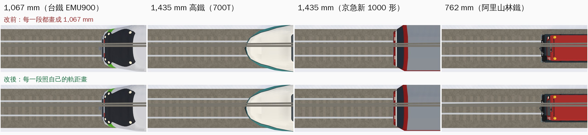

### 984. 3D 地圖的鋼軌照每段軌道自己的軌距畫

2026-11-25，雲端工作串 TRAIN-SIZE-FIX（規劃3「修正列車尺寸與軌距」），分支 `claude/project-thread-398dys`，協調者第 5 任派工。這是 `a91453/railway-assets-private-2` `docs/planning/TRAIN-SIZE-AUDIT-2026-11-25.md` 的第 1 項，也是決策 970 留在 `docs/handoff/TRACK-GAUGE.md`「還留下什麼」的第 1 條。只動 GamePresentation；存檔版本、golden schema、GameCore 不動。

## 1. 之前哪裡不對

決策 970 讓每段一般軌道有自己的軌距（`TrackEdge.gauge`），但 3D 地圖還照地區畫（`Map3DRegionLook.gauge`：芬蘭 1,524 mm，其餘 1,067 mm）。所以高鐵、捷運、輕軌、港鐵、七隈線這些 1,435 mm 的線，鋼軌畫成 1,067，照真車做的輪子每邊落在軌外約 18 cm；阿里山 762 mm 的輪子落在軌內約 15 cm。

## 2. 做了什麼

1. **玩家的軌道**（`Map3DSceneTrack.addTrack`）：每段照自己的 `gauge` 畫（`Map3DTrackGauge.drawn(_:map:)`）：762、1,067、1,435、1,524 mm。
2. **沒有設軌距的軌道**（`TrackGauge.default`，1,067 在來線級）照地圖的軌距畫，所以芬蘭地圖上這種軌道照舊是 1,524 mm（決策 799 不變），其他地圖照舊是 1,067。
3. **還沒買的真實路線的軌道**（`Map3DRealTrains` 的 `realTrack`、`realTracks`）：照那個系統的真實軌距（`TrackGauge.ofRealLine`）：台鐵 1,067；高鐵、北捷、機捷、淡海與安坑輕軌、三鶯線、高捷、台中捷運、港鐵 1,435；林鐵 762。表裡沒有的系統照地圖的軌距（和以前一樣）。
4. **菱形交叉**（決策 888）：兩股各照自己的軌距。每股的鋼軌停在另一股鋼軌（照另一股的軌距）前一個輪緣槽；八條護軌各靠自己那股的鋼軌。
5. **三線軌**（只有舊存檔轉換會產生，決策 970 §1 第 6 點）：每種軌距各畫兩條鋼軌，都對著同一條中心線。
6. 軌道種類的小零件（決策 964 的扣件、第三軌、嵌入式軌道）跟著那段最寬的軌距。

## 3. 幾個判斷

- **三線軌畫成對稱的四條，不畫成真實的三條。** 遊戲的車一律畫在軌道中心線上；真實的三線軌共用一側鋼軌，窄軌的車偏一邊走。照真實畫的話，其中一種車的輪子會有一邊落在軌外 18 cm，而且兩段頭對頭相接的地方第三條會換邊。對稱畫，兩種車的輪子都在自己的鋼軌上。1,067 與 1,435 的鋼軌中心相距 18 cm，看起來像一條寬一點的軌。這種軌道只從舊存檔轉換來，玩家鋪不出來。
- **`Map3DSceneKey` 不用加軌距。** 軌距在鋪的時候定、之後不變（決策 970 §1 第 1 點）；要換軌距只能拆掉重鋪，段數與最後一段的編號會變，場景本來就會重蓋。讀舊存檔的轉換發生在世界進場景之前。
- **道床、月台、平交道橡膠板不跟著軌距變。** 道床頂寬 3.4 m、橡膠板半寬 1.1 m，放 1,524 mm 都夠；月台緣到軌道中心的距離由車寬決定，不由軌距決定（`platformEdge` 1.6 m、`platformHeight` 1.15 m、`trackAbove` 6.5 m 都不動）。
- **沒有車型的車不跟著軌距換輪子。** 標準車與參考車種在 1,067、1,435、1,524 的軌道上都跑（決策 970），它們的模型輪距是固定的（例如四節以上通勤車的外觀是 1,435）。這類車在別的軌距上輪子仍對不上，和這張 PR 之前一樣；留在交接。

## 4. 找過什麼

| 參考 | 找到什麼 | 用到哪裡 |
| --- | --- | --- |
| 本專案決策 970（`TrackGauge.swift`）、799（`Map3DRegionLook.gauge`）、888（`Map3DDiamondCrossings`） | 每段的軌距、地區軌距、菱形交叉的算法 | 全部沿用，只把「地區軌距」換成「這段的軌距」 |
| `railway-reference-private` `Railway/rail-reference/regions/taiwan/source/rail-3d/garage-scenes/metro-kit.js` | `GAUGE` 是一個畫鋼軌的常數 | 沒有每段軌距或三線軌的畫法，沒用 |

外面的專案沒有找：這是把已有的資料接到已有的畫法上，程式是這個專案自己的。

## 5. 五個角度

| 角度 | 理由 | 分數（1–5） |
| --- | --- | ---: |
| 玩家 | 拉近看高鐵、捷運、港鐵，輪子落在鋼軌上；林鐵的軌明顯比台鐵窄 | 3 |
| 鐵道迷 | 軌距是認線的第一眼：1,435 的高鐵與捷運、1,067 的台鐵、762 的林鐵終於不一樣寬 | 5 |
| 開發 | 一個函式決定畫多寬；每種軌距、真實路線、菱形交叉、三線軌、芬蘭地圖都有測試 | 4 |
| 美術 | 車和軌對得上，側面與正面看都不再懸空 | 4 |
| 音樂 | 無 | 1 |

### 沒選的選項

- 三線軌照真實畫三條：見 §3。
- 芬蘭地圖上沒設軌距的軌道改畫 1,067：會改掉決策 799 已經上線的樣子，而且芬蘭的真實車型本來就只跑 1,524 的軌道。

## 6. 驗證

見 PR 說明（本機的建置與測試類別）。實機畫面 UNVERIFIED，等 TestFlight。

改前改後對照圖（`tools/map3d-preview`，四段平行的軌道各一種軌距，各停一節頭車，從正上方看）：

量到的模型輪距（低於軌面上 0.25 m 的頂點離車中心的距離）：700T 0.68–0.97 m、京急新 1000 形 0.63–0.81 m、環狀線 610 0.67 m 起、三鶯線 0.66 m 起、淡海輕軌 0.66–0.78 m，都是 1,435 mm 的輪子；改後這些車在自己的線上輪子壓在鋼軌上，改前鋼軌在輪子裡面約 18 cm。月台高（1.15 m）、月台緣到軌道中心（1.60 m，高鐵 1.76 m）與軌道上方淨空（6.50 m）都沒有動。

