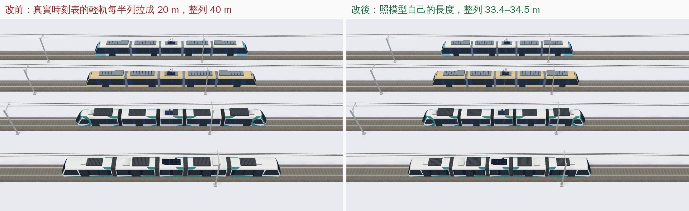

### 985. 淡海、安坑、高雄輕軌照模型自己的長度畫

2026-11-25，雲端工作串 TRAIN-SIZE-FIX（規劃3「修正列車尺寸與軌距」），協調者第 5 任派工。`a91453/railway-assets-private-2` `docs/planning/TRAIN-SIZE-AUDIT-2026-11-25.md` 的第 5 項。只動 GamePresentation；存檔版本、golden schema、GameCore 不動。

## 1. 之前哪裡不對

決策 496 把四款真實輕軌（淡海 `danhaiLRT`、安坑 `ankengLRT`、高雄 CAF `klrtCAF`、高雄 Citadis `klrtCitadis`）的五節車身從中間切成兩段，當成兩節車。模型兩段各約 17 m，整列 33.4–34.5 m，和真車一樣；但這幾組沒有標成「照模型自己的長度畫」，所以真實時刻表畫它們的時候每段被拉成一節 20 m（`Map3DRealTrains.carPitch`），整列 40 m，長了約 16%，車窗與車門跟著被拉寬。

## 2. 做了什麼

`Map3DTrainSet.fiveModuleLRT` 的四組（與它們的遠景版）標成 `ownLengths`、`fixedCars: 2`：真實時刻表的列車與玩家買下那條線之後的列車，都照兩段模型自己的長度頭尾相接地畫。模型本身一個頂點都沒動，`tools/train-models/hashes.lock.json` 不變。

| 車 | 改前 | 改後 | 真車 |
| --- | ---: | ---: | --- |
| 淡海輕軌 | 40 m | 34.45 m | 34.45 m（稽核文件，英文維基） |
| 安坑輕軌 | 40 m | 34.45 m | 同型 |
| 高雄輕軌 CAF Urbos 3 | 40 m | 34.17 m | 模型照 `tools/kaohsiung-light-rail/assembly-*.json` |
| 高雄輕軌 Citadis 305 | 40 m | 33.40 m | 同上 |

## 3. 輪距與月台

- 輪距：四款的輪子都在離車中心 0.66–0.78 m（1,435 mm），沒有動；決策 984 之後這幾條線的鋼軌也畫 1,435。
- 車寬 2.65 m、月台高 1.15 m、月台緣到軌道中心 1.60 m 都沒有動。
- 月台長度：真實路線的月台照真實資料畫，列車變短 5.5–6.6 m，只會更在月台裡。玩家買下的輕軌線，列車在 GameCore 是 C 型兩節（一節 19 m，佔 38 m）；畫出來 33.4–34.5 m，車頭對齊原來的位置，車尾比佔位短 3.5–4.6 m，不會凸出月台。要讓佔位也剛好，得給輕軌一個自己的車種長度（GameCore），留在交接。

## 4. 找過什麼

| 參考 | 找到什麼 | 用到哪裡 |
| --- | --- | --- |
| 本專案決策 399（`ownLengths`、`Map3DModelPack.layout(forType:count:)`）、決策 466（三鶯線 `fixedCars: 2`） | 兩節固定編組照模型長度畫的做法 | 原樣套用 |
| 決策 496 的模型與 `tools/new-taipei-lrt/`、`tools/kaohsiung-light-rail/` 的組裝表 | 整列長度 | 測試的期望值（原本就有） |

外面的專案沒有找：一個旗標的事，程式是這個專案自己的。

## 5. 五個角度

| 角度 | 理由 | 分數（1–5） |
| --- | --- | ---: |
| 玩家 | 輕軌不再像被拉長的車，和月台的比例對了 | 3 |
| 鐵道迷 | 整列長度與真車相同，車窗與車門不再被拉寬 16% | 4 |
| 開發 | 一個旗標，測試釘住真實時刻表與玩家兩種畫法 | 5 |
| 美術 | 模型照做的時候的比例顯示 | 4 |
| 音樂 | 無 | 1 |

### 沒選的選項

- 把模型拉長到 40 m：違反作者 2026-11-25 的規則（用真車尺寸）。
- 同時給輕軌一個 17.2 m 的 GameCore 車種：要動車種表，和京急 18 m 車種（決策 986）一起考慮，不在這張做。

## 6. 驗證

見 PR 說明。改前改後對照圖（`tools/map3d-preview`，由上而下：淡海、安坑、高雄 CAF、高雄 Citadis）：

實機畫面 UNVERIFIED，等 TestFlight。
