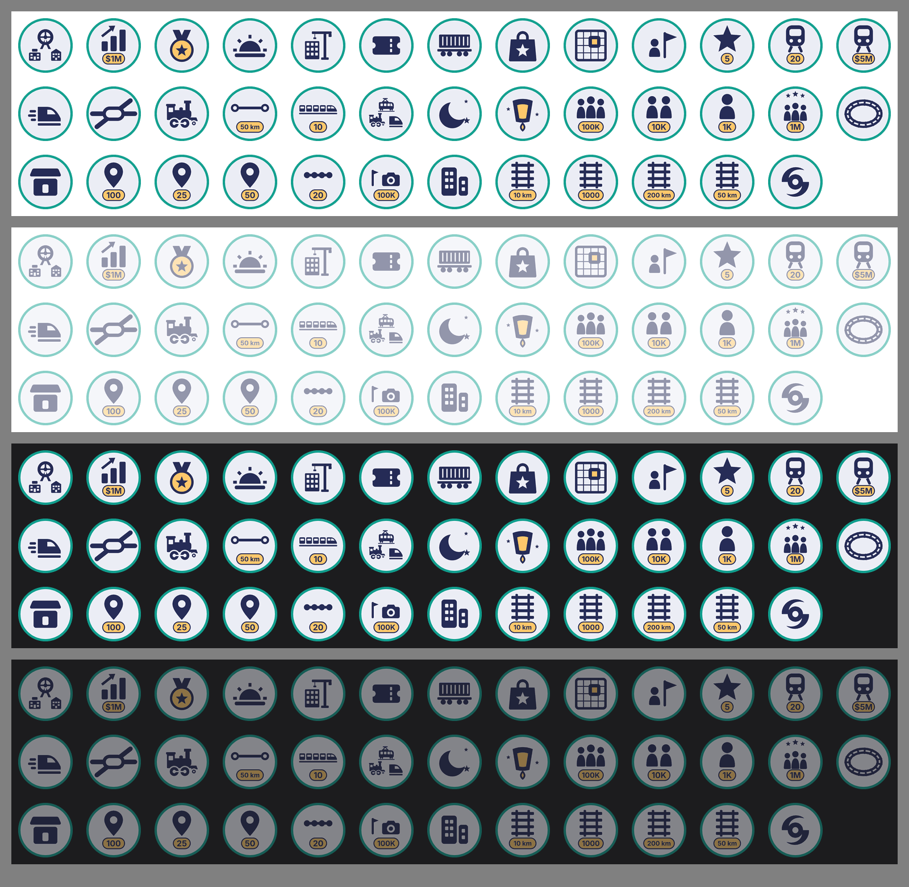
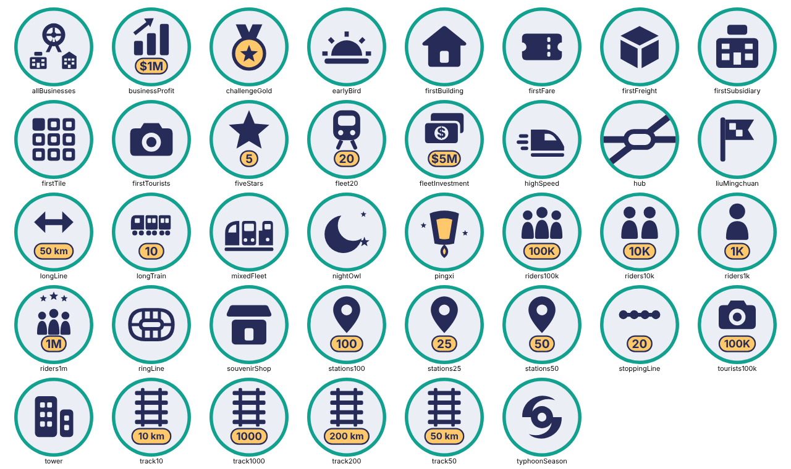

# Game Center 的成就圖（決策 396）

38 張 1024×1024 的 PNG（Apple 要的 512×512 pt @2x），一個成就一張，檔名就是 Game Center 的成就 ID（`achievement.<遊戲內 ID>.png`）。作者在 App Store Connect 建成就時上傳（`docs/GAME_CENTER_SETUP.md` 第 4 步）。

遊戲內的成就清單也用同一張圖（決策 396 續二）：這 38 張縮成 64 和 96 px（32 點的 @2x、@3x）、裁成圓形，放在 `RailwayGameApp/Resources/Assets.xcassets/Achievements/Achievement-<遊戲內 ID>.imageset`，共約 145 KB。App 不讀這個資料夾的 1024 px 原檔。改了這裡的圖，要重新縮一次（做法在決策 396 續二）；`AchievementsTests.testEachHasItsBadgeInTheAssetCatalog` 檢查每個成就兩邊都有圖。

## 樣子

- 照 `.claude/skills/art-style/SKILL.md`：扁平、實心色塊、藏青外框，顏色只用 App 圖示的四色（藏青 `#262C57`、綠松 `#12A08F`、暖黃 `#FFC86B`、淺底 `#ECEEF6`）。
- Game Center 把成就圖裁成圓形顯示，所以圖都畫在中間的圓裡：綠松色的底和圈、淺色的圓面，中間一個藏青的圖示。
- 同一系列用同一個圖示，等級寫在下面的暖黃標籤上（1K、10K、10 km、25……）。數字中英文通用，所以兩種語言用同一張。
- 載客的系列照 art-style「等級用同一種人形的人數表示」：1K 一個人、10K 兩個人、100K 三個人，1M 是三個人頭上再加三顆星。
- 用到 App 裡現有的圖示：`MapGlyphPerson`、`MapGlyphCrowd`、`MapGlyphFull`、`MapGlyphStar`、`MapGlyphTyphoon`、`MapGlyphOffice`、`MapGlyphHouse`、`MapGlyphShop`、`MapGlyphDepartmentStore`、`MapGlyphAmusementPark`、`MapGlyphHotel`、`MapGlyphTrain`。其他（車票、軌道、站點、箭頭、停靠點、日出、月亮、環狀軌道、轉乘站、流線車頭、貨箱、地圖網格、金牌、天燈、騰雲號、購物袋、相機、長條圖、長編組、三種車頭、一疊鈔票）是這次新畫的，同樣 24 格、實心、圓角。
- 沒有用參考庫的圖，也沒有用 SF Symbols（Apple 的授權不准把 SF Symbols 用在 App 以外的圖上）。

## 美術審查後改了什麼（2026-10-24）

審查是 session_01T1XU 做的，總覽在 `claude/art-review-1158:docs/game-center/review/overview.png`。

- 輸出改成 1024×1024。
- 拿掉最外圈 30 px 的藏青，圖示放大約 13%。
- 環狀線：改成首尾相接、帶枕木的環狀軌道（原本像 ♂）。
- 轉乘：一座站，三條方向不同的路線從站穿過（原本中心有殘片，像分子模型）。
- 軌道：1000 km 的標籤只寫 1000。所有標籤都收在圓面裡，不碰綠圈。
- 挑戰金牌：暖黃的牌面。
- 平溪線：天燈，裡面透著暖黃的光，下面有火（原本是號誌燈）。
- 車種齊全：三種不同的車頭並排（原本和車隊成形同圖）。
- 車隊投資：一疊鈔票，中間一個 $（原本像相機）。
- 企業集團：百貨、飯店、遊樂園三個小圖。
- 百萬運量：三個人頭上加三顆星，和 100K 分得開。
- 子彈列車：流線車頭加速度線（原本只有閃電）。
- 夜行者：星星離開月牙。

每張都在 64 和 40 px 的圓形裁切、模糊、灰階下看過。

作者看過總覽後，遊戲規劃用 40 px 灰階再看一次，改了：
- 劉銘傳：騰雲號（劉銘傳時代的蒸汽機車）的側面剪影，矮車身、高煙囪、大動輪，車頭朝右（原本的格子旗是賽車的終點旗）。
- 開疆闢土：一張地圖的細線網格，其中一格填暖黃，是買下的那一格（原本的 3×3 圓角方格像手機桌面）。
- 多角經營：購物袋上一顆星（原本像公事包或急救箱）。
- 轉乘：兩條線的兩端收在圓面裡，不碰綠圈。

第二輪審查（session_01XHRSea，`claude/art-review-1158:docs/game-center/review/round2.png`）之後：
- 轉乘：改成路線圖的轉乘站記號，一個白底、藏青粗框的膠囊形站體，一條水平線、一條斜線穿過它，兩端都接到圓面邊緣（原本的橢圓加六根輻條像蜘蛛或雪花，斷在站外的版本像太陽）。
- 環狀線：兩條軌道圍成一圈，枕木畫在兩軌之間（原本伸出外面，像晶片針腳）。
- 企業集團：摩天輪是主體，百貨和飯店小小地放在下面。
- 車種齊全：三個正面車頭並排站在同一段軌道上，中間最前面是通勤電聯車（方形車身、大擋風窗、兩顆頭燈），左後是高鐵（圓頂、弧形擋風窗），右後是蒸汽機車（圓形煙室門、煙囪）。原本側面和正面混在一起，又像擺在架子上（作者：「有點怪怪的」）。

第三輪審查（標準：不看標題，玩家看圖猜得到是哪個成就；PR #1158 的審查留言）之後改了 9 張：
- 車種齊全：三台車都畫側面、車頭朝右，排成三角形，彼此分開，不共用軌道：上面是單節通勤電聯車（車頂有集電弓，車底兩組小轉向架，站在一條細軌上），左下是騰雲號的剪影，右下是子彈列車的車頭（拿掉速度線）。原本三台的角度不同，擠在一起，40 px 下只剩一塊。
- 一日遊：導遊舉著三角旗（原本只有一台相機，像相機 App，又和觀光旺季同圖）。
- 觀光旺季：同一面三角旗加相機，標籤 100K 不變。兩張靠三角旗看得出是同一系列。
- 長編組：一列 5 節的細長列車，每節一條窗帶，領頭那節是子彈列車的車頭（同一條鼻子曲線與斜擋風窗），下面一條軌道（原本的三個方塊加一排圓點像機櫃或錄音帶）。
- 繞圈圈：兩條軌道圍成橢圓，枕木在兩軌之間，中間留空（原本中間的長圓讓它像露牙的嘴）。
- 建商起步：蓋到一半的樓加一座塔吊（原本的小房子像「首頁」按鈕）。
- 第一噸貨：平車載一個貨櫃的側面（原本的立方體像 3D 圖示）。
- 一氣呵成：兩個終點站中間一條長線，和「站站是風景」同一種路線畫法（原本的雙箭頭像「調整大小」）。
- 車隊投資：車隊成形的列車正面，標籤換成 $5M（原本的鈔票看不出是買車）。

## 選了哪一種

- **A（用了）**：淺色圓面、藏青圖示、綠松色的圈（`overview.png`，審查後的版本）。
- **B（沒用）**：綠松色圓面、淺色圖示、暖黃的圈（`option-b-teal.png`，審查前的畫法）。

五方：
- 玩家：A 在 Game Center 的白底與深色模式都分得清，圖示是深色的，小尺寸也看得出。B 整片綠松，38 個並排時比較吵。
- 鐵道迷：圖示用軌道、車票、天燈、旗子，看得出是鐵道遊戲。
- 開發：用腳本產生，換成就時重跑就好（腳本留在 scratchpad，照 art-style 不放進 repo）。
- 美術：A 和 App 圖示的淺底藏青一致，B 的大片綠松在 App 裡只當強調色用。
- 音樂：無。
