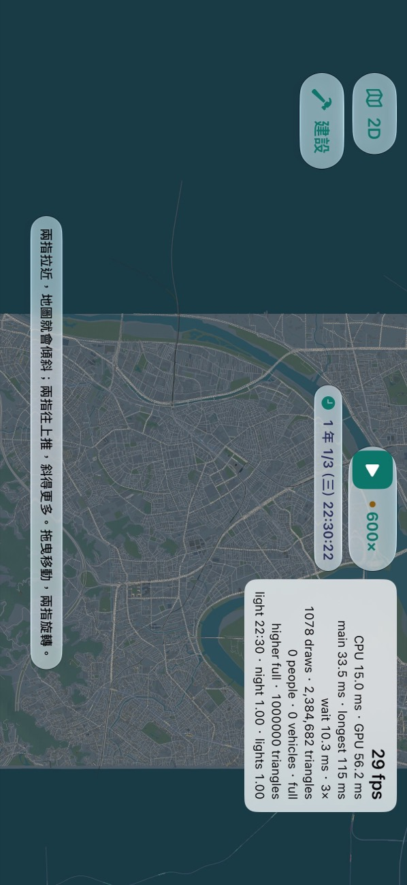
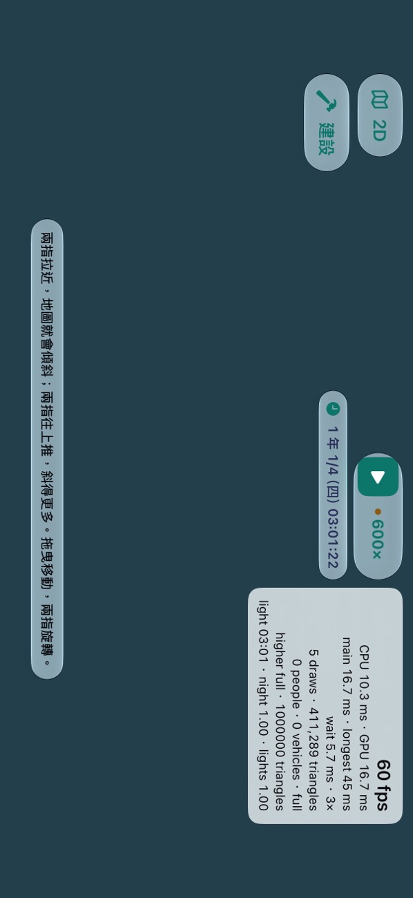

# DEVICE-C 量測（2026-11-13）

派工單 DEVICE-C（遊戲規劃第 64 任，#1579 留言 6841570600）。只量不改。第一段在 iPhone 模擬器，第二段在實機 iPhone 17 Pro。

## 1. PERF-FAR-VERIFY：#2098（決策 709）在 #2105（決策 711）之後還省不省

### 1.1 結論

**還省，而且省很多：不建議關掉 #2098。** 同一個存檔、同一個座標、同一批區塊，鏡頭停在 12 km：

| 存檔／地點 | 區塊 | main `65f6461` 三角形／draw | `claude/perf-far`（併 main 後 `a9c822c`）三角形／draw | 少 |
| --- | ---: | ---: | ---: | ---: |
| A「整個臺灣」，台北車站 25.0478,121.5170 | 282 | 2,487,942／956 | 475,396／863 | 81 % |
| B（103 站 150 列車），三重 25.0600,121.4870 | 265 | 2,363,046／1,017 | 784,795／899 | 67 % |
| A，苗栗車站 24.5701,120.8225（郊區） | 131／130 | 557,837／526 | 115,776／409 | 79 % |

- #2105 之後 main 在市區的最遠視野**不在 100 萬附近**：停在 236–249 萬，正好是高階機的每格預算（240 萬，決策 711）。也就是 main 靠預算擋著；#2098 讓同一格降到 48–78 萬，離預算很遠。
- 存檔 B 比存檔 A 多的那 30 萬（78 對 48），是玩家收購的捷運軌道與高架：709 明寫鐵路永遠全畫。
- 繪製次數只少一成上下（709 的「沒做的」已寫：每塊最多四次沒變）。
- 記憶體沒有看得出的差別（709 只換索引順序，緩衝一樣大）：App 自己的診斷紀錄（`frame-times.json`）那一段的峰值，台北 1,376 對 1,372 MB、三重 1,380 對 1,365 MB。苗栗是 875 對 1,233 MB，perf-far 反而高，原因沒有查（峰值含建場景途中的暫時用量，兩次暫停的時間點也不同）；不能當成 709 多用記憶體的證據，也不能當成沒差的證據。
- 每格時間：模擬器用的是 Mac 的 GPU，兩邊都是 60 fps、CPU 4–6 ms、GPU 0.2–0.5 ms，分不出來；**實機的每格時間要看第 3 節**。

### 1.2 樣子（請規劃看圖）

每張都是鏡頭正上方 12 km、暫停、裝置分級指定為高階（`-screenshot-device-tier 2`）。

| | main | perf-far |
| --- | --- | --- |
| 存檔 A 台北 |  |  |
| 存檔 B 三重 |  |  |
| 存檔 A 苗栗 |  |  |

看到的：

- main 的最遠視野是一整片灰色的建築顆粒，路網被蓋住；perf-far 剩地面、土地利用、水、幹道、鐵路與大建築，路網與河清楚。
- **苗栗（郊區）在 perf-far 幾乎沒有建築**：鄉鎮的房子都小於 12 km 時的門檻（34 m），市區只剩路。台北與三重還看得到大樓。覺得太空的話，709 留的後手是把 `Map3DFarDetail.slope` 調小。
- 這些圖是正上方看；傾斜看、以及拉遠途中一級一級換的樣子，這裡沒有拍（要手動拉，見 1.4）。

### 1.3 合併時看到的一件事（沒有改，報給規劃）

`claude/perf-far` 併 main 只有兩個檔衝突（`Map3DMetalView.swift`、`Map3DScene.swift`），都是 711 的「這一塊這一格畫多少」（`share`）和 709 的「遠景畫到哪一級」（`farLevels`）改到同一行，兩邊都留：遠景塊在 `share` 允許畫城市時畫 709 的那一段，`share` 只剩地面時不畫城市。

但 **711 的預算不知道 709 省了多少**：`Chunk.cost(pack:)` 算遠景塊的成本用的是整份簡化城市、整份盒子、整份陰影的三角形數，不是這一格 709 實際要畫的那一段。所以併起來之後，預算仍照 main 的 236–249 萬在分，視野邊緣的區塊可能照舊被改成「只剩地面」，而實際上整格只畫了 48–78 萬、根本放得下。上表 perf-far 的數字因此可能略偏低（少畫了邊緣幾塊的大建築），畫面邊緣也可能比該有的空。這是讀程式得到的，沒有在畫面上分辨出是哪幾塊。

修法很小（`cost` 的 `simplified` 改用這一格的 `farLevels[level]`），但那是改做法，不是解衝突，這個 session 只量不改，留給規劃派。

### 1.4 怎麼量的

- 兩個 Debug 版（`xcodebuild … -configuration Debug`，模擬器 iPhone 17 Pro，iOS 27.2）：main `65f6461`、`claude/perf-far` 併 main 後的 `a9c822c`。
- 存檔用實機備份（`~/RailwayGameDeviceBackups/2026-11-13-before-perf-open3d-device/`）：A 是 `save-2026-11-12 203909`、B 是 `save-2026-11-12 120131`。把要量的那一份複製成模擬器 App 容器裡的 `autosave.json`，開始畫面按「繼續」，不用進存檔清單。
- 啟動參數：`-map.showsFrameRate YES -screenshot-3d-view 12000,0,0 -screenshot-3d-at <緯度>,<經度> -screenshot-device-tier 2`。模擬器的 GPU 沒有分級，不給最後一個參數的話預算是最低那一級（100 萬），和 iPhone 17 Pro 不一樣。
- 暫停、按 3D、等串流停住（約 3 分半，讀數連續兩次不變），點右上的讀數展開，讀 draws／triangles；關掉 3D 後讀 App 容器裡 `Diagnostics/frame-times.json` 那一段的區塊數與記憶體峰值，確認兩邊是同一批。
- **坑**：
  - 遊戲沒暫停時（150 列車的存檔 B 開著 600×）畫質階梯會自己往下降，預算跟著變，數字不能比。存檔 B 讀進來本來就是暫停的，不要再按。
  - 用啟動參數擺鏡頭時，載入的是鏡頭目標四周的串流範圍（半徑約 3 km）加場景本體，不是 12 km 視野裡的每一塊；真的用手拉到最遠時載入的範圍會隨拉的過程不同。這裡比的是「同一批區塊」，不是絕對的最壞情況（709 在 Linux 上算的 544 塊才是上限）。
  - 這台 Mac 同時有別的對話的模擬器在跑同一個 App：`pgrep RailwayGame` 會抓到別人的行程。一開始用 `footprint $(pgrep …)` 讀記憶體，有幾筆讀到的是別人的 App，已經不用；要用 pid 的工具（`footprint`、`lldb -p`）先用模擬器的 UDID 篩。
  - 存檔 A 第一次跑（暫停在遊戲 12:23）只載入了 161 萬三角形的那一圈；之後幾次（暫停在 14:02–14:03）多一塊東邊的區塊，main 是 249 萬。為什麼多那一塊沒有查。同一個時間點兩邊比才算數，上表都是後者。

### 1.5 本機檢查

- VERIFIED（Mac，Swift 6.4）：併 main 後的 `claude/perf-far` 上 `swift build --build-tests -Xswiftc -warnings-as-errors`；`Map3DFarViewTests`（5 個，2 個照設計略過）、`Map3DSceneBudgetTests`（11 個）、`Map3DStreamingTests`（18 個）全過；兩個分支的模擬器 Debug 建置 BUILD SUCCEEDED。
- 其餘測試交 CI。

## 2. 「不暫停、600× 開 3D，畫面有飛機但沒有跟隨列」（PERF-OPEN3D 沒解釋的那一次）

**是那班飛機自己結束，不是跟隨被踢掉。** 模擬器，main `726da5f`（含 #2107）的 Debug 版，存檔 A，鏡頭在桃園機場（`-screenshot-3d-view 600,0,45 -screenshot-3d-at 25.0790,121.2360 -screenshot-3d-follow-aircraft`），遊戲 600× 不暫停直接按 3D；用 lldb 在 `GameSession.followAircraft` 與 `noteFollowedAircraft` 下只記錄、不停住的中斷點：

| 遊戲秒 | 發生什麼 | 遊戲速度 |
| ---: | --- | --- |
| 118,560 | 開始跟隨：窄體客機，離場，後推中 | 那一刻時鐘記的是 `normal`（為什麼不是 600× 沒有查），跟上之後 10×（跟隨時的上限） |
| 118,560 之後 | 滑出 | 10× |
| 118,817 | 對正跑道 | 10× |
| 118,841 | 起飛滾行 | 10× |
| 118,874 | 爬升 | 10× |
| 118,918 | 3D 回報「這班不能再跟」（`nil`）：爬升飛走，放開，鏡頭留在原地 | 放開後回到 600× |

- 從跟上到放開是 358 遊戲秒，10× 下約 36 秒；放開之後遊戲回到 600×，再過十幾秒畫面上的時鐘就多了好幾個小時（截圖時已是當天 15:19），畫面上沒有跟隨列、機場照樣有別的飛機。這和 PERF-OPEN3D 看到的「15 秒後有飛機但沒有跟隨列、遊戲已過約 3.5 小時」是同一件事；那次跟到的那一架離結束比較近而已。
- `nil` 是從 `Map3DTrainFeed.aircraftPose` 來的（呼叫堆疊如此），那時機場不在重鋪中；前一個狀態是「爬升」。沒有看到跟隨在滑行或滾行途中被放開。
- `-screenshot-3d-follow-aircraft` 只會跟第一架，放開後不會再找下一架（本來就這樣寫的）。
- 沒試到的仍是 #2107 交接寫的那一個：跟隨途中機場重鋪（場景原點或機場數變了）。

## 3. 實機（iPhone 17 Pro）

main `726da5f`（含 #2105、#2107）的 Release 組態，開發簽章，`devicectl` 裝；裝之前把手機的 `Application Support` 備份到 Mac 的 `~/RailwayGameDeviceBackups/2026-11-13-before-device-c/`，六筆存檔都在。操作用 FPS-DEVICE 留下的那支不進 repo 的遙控 UI 測試（已經建好的，沒有重建），數字來自 App 自己的紀錄（`frame-times.json`）、畫面上的讀數與 Xcode 的 Time Profiler（`xctrace`，接在遊戲自己的行程上）。**都是遙控量的，不是手動**；手機開始時是 `fair`，3D 跑了三分鐘後升到 `serious`。

### 3.1 存檔 B、2D、600×：每 tick 多久、60 % 上限佔多少（第 1 項）

| | 第一次 | 第二次 |
| --- | --- | --- |
| 真實秒數 | 122 | 102 |
| 遊戲時鐘 | 1/2 09:24:22 → 1/3 05:38:22 | 1/3 05:38:22 → 1/3 22:30:22 |
| 實際倍數 | **597×** | **595×** |
| 畫面 | 60 fps，間隔最長 39.3 ms，0 次頓 | 60 fps，最長 16.7 ms，0 次頓 |
| 溫度 | fair | fair |

- **手機不燙時，150 列車的存檔 B 跟得上 600×。** 紀錄裡寫著這台是「CPU higher, ticks at most 100% of the time」：`TickPace` 的上限在高階機是 100 %，只有溫度到 `serious` 才降成 60 %（`critical` 40 %）。所以 60 % 不是平常就有的限制。
- Time Profiler（第二次，取樣 50.8 秒）：堆疊裡有遊戲迴圈那一段（`LoopTick`／`GameSession.advanced`／`GameWorld.advance`／`PassengerRoutesAhead`）的取樣合計 **每真實秒 616 ms 的 CPU**，分在 6 條執行緒上；照取樣的時間分群，是**每秒 3.57 段、每段中位數 181 ms（p90 206、最長 223 ms）**，合計佔真實時間的 **62 %**。其中 `GameWorld.advance` 每秒 417 ms，地圖滑行（`TrainMotion.init`）128 ms，乘客路網（`PassengerRouteGraph.init`）115 ms，乘客計畫 82 ms。主執行緒每秒 187 ms。
- **所以上限佔多少**：不燙時遊戲迴圈要用 62 % 的時間，上限 100 %，沒有被限制。燙到 `serious` 時上限 60 %，比要用的 62 % 只少一點點；FPS-DEVICE 那次只剩 372×，差的那一大截不是上限本身，是燙的時候每 tick 變慢（作者那次讀到 400–650 ms，這次不燙是 181 ms）。這次沒有在燙的 2D 重量一次來分開這兩者（3.2 的 258× 是 3D 開著、畫面也在搶）。
- 對 TICK-L1/L2 的意思：不燙時還有約四成餘裕，燙了才掉。要不要派，看要不要顧「玩久了、手機燙了」的情況。

### 3.2 存檔 B 開 3D、拉最遠、3D 600×（第 2、3 項）

存檔 B 讀進來的位置（台北），暫停著按 3D，捏四次到最遠，停 25 秒；再開 600× 跑 63 秒。遊戲裡是夜晚（22:30–03:01）。

| 情境 | 秒 | 間隔 中位數／p95／p99／最長 | CPU 中位數／p95 | GPU 中位數／p95 | draw | 三角形 | 區塊 | 記憶體峰值（剩） | 頓 短／長／嚴重 | 溫度 |
| --- | ---: | --- | --- | --- | ---: | ---: | ---: | --- | --- | --- |
| 開 3D＋拉到最遠（暫停） | 180 | 29.2／50／58.3／104.2 | 13.5／18.4 | **52.6**／72.8 | 1,078 | **2,384,692** | 285 | **1,674 MB**（1,701） | 402／2／0 | serious |
| 最遠，600× | 63 | 37.5／83.3／108／150 | 18.3／23.9 | **57.8**／75.8 | 1,078 | 2,385,352 | 285 | 1,717 MB（1,658） | 306／32／0 | serious |
| 同一畫面，暫停 | 10 | 33.3／58.3／62.5／70.8 | 13.5／17.4 | 57.2／74.9 | 1,078 | 2,385,342 | 285 | 1,660 MB | 39／0／0 | serious |

和 FPS-DEVICE 那次（#2105 之前，同一個存檔）比：

- **三角形 830–892 萬 → 238 萬，記憶體 3,327 MB（只剩 48 MB、2 次警告）→ 1,674 MB（剩 1.7 GB、0 次警告）。#2105 把「快被系統殺掉」解掉了。**
- **但 GPU 一格還是 53–58 ms，畫面約 27–31 fps，和之前的 52 ms 幾乎一樣。** 三角形少了七成、GPU 時間沒有跟著少，所以最遠視野慢的主因不是三角形數（這一格是夜晚，窗燈與路燈都亮著；也可能是填滿畫面的像素量或 1,078 次繪製）。是哪一樣，這次沒有分開。#2098 在模擬器少的也是三角形（第 1 節），它在實機能不能讓 GPU 變快，因此**不能從三角形數推論，要裝上去量**。
- 畫質階梯全程停在最高（`higher full`），沒有往下降。
- 3D 600× 的遊戲時鐘：63 秒走了 16,260 遊戲秒，**258×（43 %）**；手機是 `serious`（上限 60 %），畫面也在用 CPU。
- **開 3D 的那一格（第 4 項的一部分）**：這一段 180 秒裡最長的間隔是 104.2 ms，而且出現在第 179.5 秒，不是剛開的時候；也就是這次從 2D 開 3D 沒有超過 104 ms 的一格（FPS-DEVICE 是 383–1,200 ms，#2107 交接是 121 ms）。這是遙控、手機 fair 時開的，不是派工單要的「手動、放涼」。
- 最遠視野只有中間一條有地面（下圖兩側的深色是沒有東西）：載入的 285 塊是鏡頭目標四周那一圈，停 25 秒也沒有再多。

### 3.3 最遠視野快速拖動後的空地（第 5 項）：重現了，沒有做前後對照

main（含 #2105）、最遠視野、暫停，連續快拖三次（每次約半個螢幕寬、0.05 秒），拖完後 0、5、12、22 秒各拍一張：**四張都是整片空的**，讀數停在 5 draws／411,289 triangles，22 秒後仍然沒有地面出現（下圖）。比派工單寫的「約 10 秒」久。

- 拖完後鏡頭在哪裡沒有記（遙控測試讀不到座標）；三次合計約拖了一個半螢幕，照最遠視野的比例應該還在台北盆地東南的陸地上，但**不能排除已經拖出有資料的範圍**。
- **沒有裝 `cfc051d` 來比**（要再建一版 Release、約 25 分鐘，而且手機已經燙了），所以「是不是 #2105 造成的」這一題沒有答案。重現步驟：存檔 B、按 3D、捏到最遠、往同一個方向快拖三次、停著看。

### 3.4 午夜（第 6 項，REVIEW-L19 P2-3）

這次過了兩次午夜，都沒有長停頓：

- 2D、600×、fair（3.1 第一次，1/2 → 1/3）：整段最長間隔 39.3 ms，0 次頓。
- 3D 最遠、600×、serious（3.2，1/3 → 1/4）：整段最長 150 ms，沒有 250 ms 以上的。

FPS-DEVICE 那次是存檔 A 的桃園機場 3D；這次是存檔 B、鏡頭不在機場。機場旁、不燙、手動的那一種仍然沒量。

### 3.5 模擬器抽查（FIX-L19-P3 的 UNVERIFIED）

main `726da5f` 的 Debug 版、存檔 A：

- **VERIFIED**：圖鑑 → 飛機，點「七十座雙渦輪螺旋槳」開的是那一架，關掉再點「十九座雙螺旋槳」開的是另一架；每張卡的「看得到的機場」都有列出來。（是開、關、再開；沒有試很快地連點。）
- **VERIFIED**：觀光景點面板的「機場」那一節照常出現（桃園第一、第二航廈的架次、旅客與航線）。
- 沒做：駕駛把手切 App 後不跳格、機場旁車站可點／機身可跟／夜間飛機燈、集集保安站名牌（存檔裡沒有蓋在那兩站的車站，鏡頭擺到集集只看到一般建築）、示範地圖鋪「高鐵 台中–彰化」（第 7 項）。

### 3.6 沒做的

| 項 | 為什麼 |
| --- | --- |
| 第 4 項 手動、放涼量 #2107 的第一格 | 要作者的手；遙控量到的上界見 3.2 |
| 第 5 項 `cfc051d` 對照 | 見 3.3 |
| 第 2 項的「放涼」 | 最遠視野一開，三分鐘內就從 fair 升到 serious；表裡的數字是升溫途中的 |
| 第 7 項 高鐵示範抽查、FIX-L19-P3 其餘三項 | 沒排到（這個 session 已壓縮一次，不再往下接） |

### 3.7 手機現在的狀態

- 裝的是 main `726da5f` 的開發簽章 Release 版（版本 0.6.0，build 128）。
- 六筆存檔都在，沒有刪、沒有另存。存檔 B 被讀進去跑過（遊戲時鐘從 1/2 09:24 到 1/4 03:01），遊戲自己的 `Versions/save-2026-11-12 120131/autosave.json` 可能因此更新；`save-2026-11-12 120131.json` 本身沒有按儲存。量之前的整份在 Mac 的備份裡。
