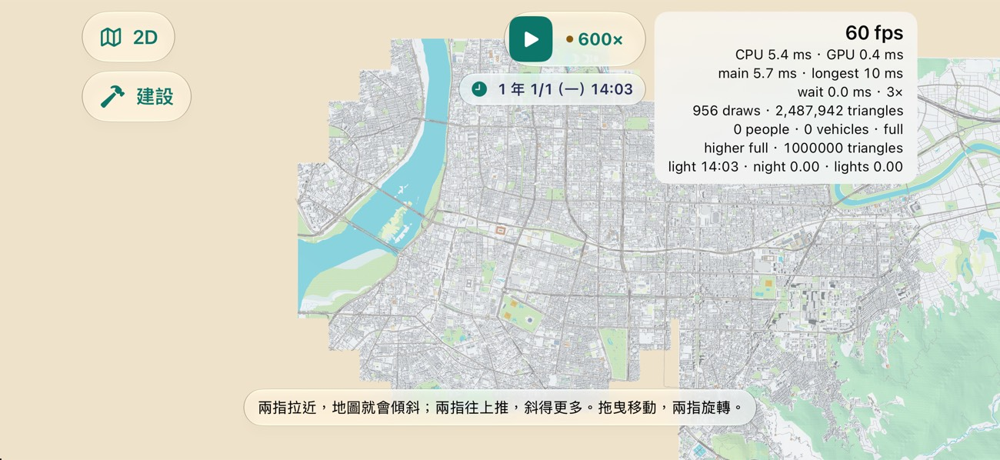
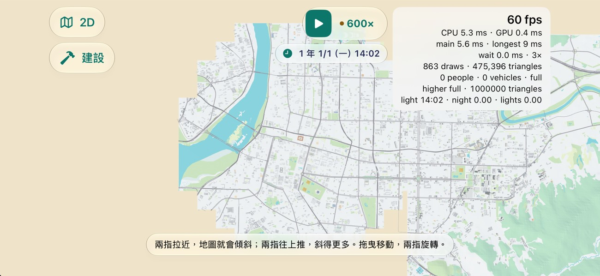
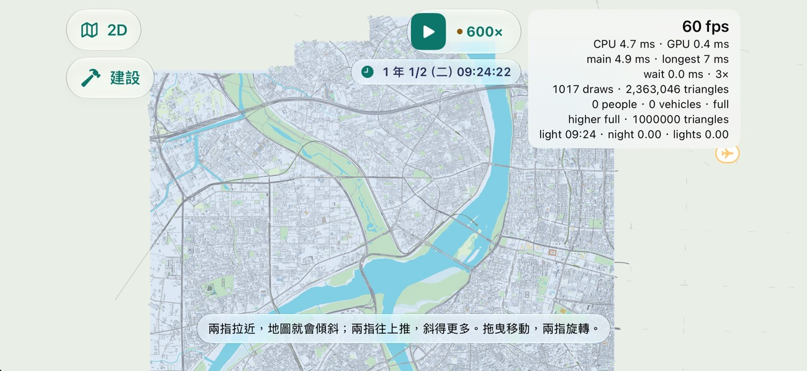
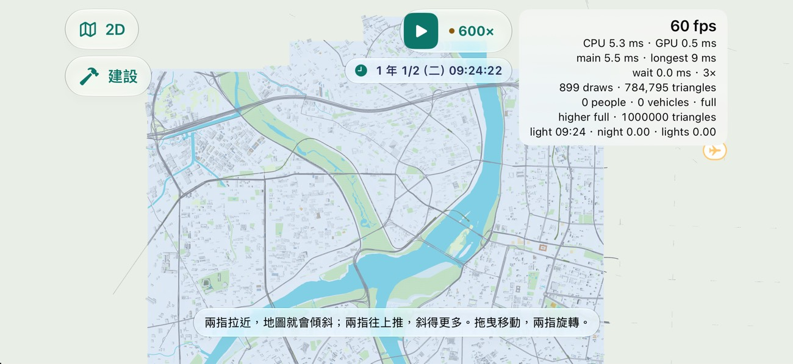
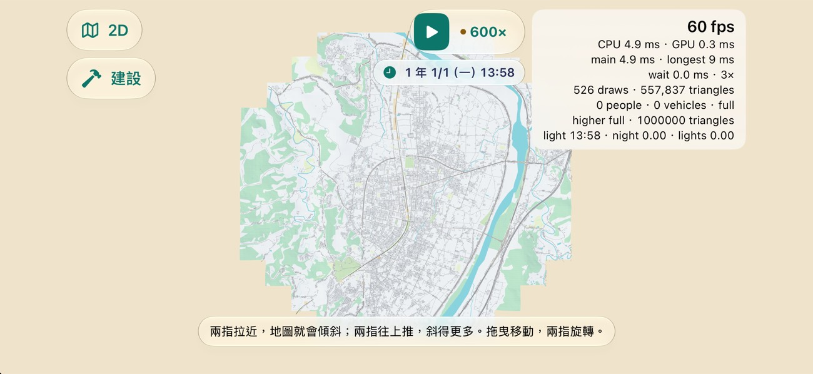
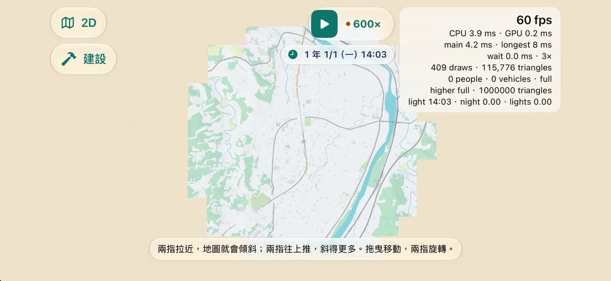

# DEVICE-C 量測（2026-11-13）

派工單 DEVICE-C（遊戲規劃第 64 任，#1579 留言 6841570600）。只量不改。第一段在 iPhone 模擬器，第二段在實機 iPhone 17 Pro。

## 1. PERF-FAR-VERIFY：#2098（決策 709）在 #2105（決策 711）之後還省不省

### 1.1 結論

**還省，而且省很多：不建議關掉 #2098。** 同一個存檔、同一個座標、同一批區塊，鏡頭停在 12 km：

| 存檔／地點 | 區塊 | main `65f6461` 三角形／draw | `claude/perf-far`（併 main 後 `a9c822c`）三角形／draw | 少 |
| --- | ---: | ---: | ---: | ---: |
| A「整個臺灣」，台北車站 25.0478,121.5170 | 282 | 2,487,942／956 | 475,396／863 | 81 % |
| B（103 站 150 列車），三重 25.0600,121.4870 | 265 | 2,363,046／1,017 | 784,795／899 | 67 % |
| A，苗栗車站 24.5701,120.8225（郊區） | 131／130 | 557,837／526 | 115,776／409 | 79 % |

- #2105 之後 main 在市區的最遠視野**不在 100 萬附近**：停在 236–249 萬，正好是高階機的每格預算（240 萬，決策 711）。也就是 main 靠預算擋著；#2098 讓同一格降到 48–78 萬，離預算很遠。
- 存檔 B 比存檔 A 多的那 30 萬（78 對 48），是玩家收購的捷運軌道與高架：709 明寫鐵路永遠全畫。
- 繪製次數只少一成上下（709 的「沒做的」已寫：每塊最多四次沒變）。
- 記憶體沒有看得出的差別（709 只換索引順序，緩衝一樣大）：停住後的 footprint 台北 1,377 對 1,372 MB、苗栗 813 對 813 MB；三重讀到 1,178 對 1,365 MB，但 main 那一段的峰值也是 1,380 MB，差在讀的時間點，不是分支。
- 每格時間：模擬器用的是 Mac 的 GPU，兩邊都是 60 fps、CPU 4–6 ms、GPU 0.2–0.5 ms，分不出來；**實機的每格時間要看第 2 節**。

### 1.2 樣子（請規劃看圖）

每張都是鏡頭正上方 12 km、暫停、裝置分級指定為高階（`-screenshot-device-tier 2`）。

| | main | perf-far |
| --- | --- | --- |
| 存檔 A 台北 |  |  |
| 存檔 B 三重 |  |  |
| 存檔 A 苗栗 |  |  |

看到的：

- main 的最遠視野是一整片灰色的建築顆粒，路網被蓋住；perf-far 剩地面、土地利用、水、幹道、鐵路與大建築，路網與河清楚。
- **苗栗（郊區）在 perf-far 幾乎沒有建築**：鄉鎮的房子都小於 12 km 時的門檻（34 m），市區只剩路。台北與三重還看得到大樓。覺得太空的話，709 留的後手是把 `Map3DFarDetail.slope` 調小。
- 這些圖是正上方看；傾斜看、以及拉遠途中一級一級換的樣子，這裡沒有拍（要手動拉，見 1.4）。

### 1.3 合併時看到的一件事（沒有改，報給規劃）

`claude/perf-far` 併 main 只有兩個檔衝突（`Map3DMetalView.swift`、`Map3DScene.swift`），都是 711 的「這一塊這一格畫多少」（`share`）和 709 的「遠景畫到哪一級」（`farLevels`）改到同一行，兩邊都留：遠景塊在 `share` 允許畫城市時畫 709 的那一段，`share` 只剩地面時不畫城市。

但 **711 的預算不知道 709 省了多少**：`Chunk.cost(pack:)` 算遠景塊的成本用的是整份簡化城市、整份盒子、整份陰影的三角形數，不是這一格 709 實際要畫的那一段。所以併起來之後，預算仍照 main 的 236–249 萬在分，視野邊緣的區塊可能照舊被改成「只剩地面」，而實際上整格只畫了 48–78 萬、根本放得下。上表 perf-far 的數字因此可能略偏低（少畫了邊緣幾塊的大建築），畫面邊緣也可能比該有的空。這是讀程式得到的，沒有在畫面上分辨出是哪幾塊。

修法很小（`cost` 的 `simplified` 改用這一格的 `farLevels[level]`），但那是改做法，不是解衝突，這個 session 只量不改，留給規劃派。

### 1.4 怎麼量的

- 兩個 Debug 版（`xcodebuild … -configuration Debug`，模擬器 iPhone 17 Pro，iOS 27.2）：main `65f6461`、`claude/perf-far` 併 main 後的 `a9c822c`。
- 存檔用實機備份（`~/RailwayGameDeviceBackups/2026-11-13-before-perf-open3d-device/`）：A 是 `save-2026-11-12 203909`、B 是 `save-2026-11-12 120131`。把要量的那一份複製成模擬器 App 容器裡的 `autosave.json`，開始畫面按「繼續」，不用進存檔清單。
- 啟動參數：`-map.showsFrameRate YES -screenshot-3d-view 12000,0,0 -screenshot-3d-at <緯度>,<經度> -screenshot-device-tier 2`。模擬器的 GPU 沒有分級，不給最後一個參數的話預算是最低那一級（100 萬），和 iPhone 17 Pro 不一樣。
- 暫停、按 3D、等串流停住（約 3 分半，讀數連續兩次不變），點右上的讀數展開，讀 draws／triangles；記憶體用 `footprint <pid>`；關掉 3D 後讀 App 容器裡 `Diagnostics/frame-times.json` 那一段的區塊數，確認兩邊是同一批。
- **坑**：
  - 遊戲沒暫停時（150 列車的存檔 B 開著 600×）畫質階梯會自己往下降，預算跟著變，數字不能比。存檔 B 讀進來本來就是暫停的，不要再按。
  - 用啟動參數擺鏡頭時，載入的是鏡頭目標四周的串流範圍（半徑約 3 km）加場景本體，不是 12 km 視野裡的每一塊；真的用手拉到最遠時載入的範圍會隨拉的過程不同。這裡比的是「同一批區塊」，不是絕對的最壞情況（709 在 Linux 上算的 544 塊才是上限）。
  - 存檔 A 第一次跑（暫停在遊戲 12:23）只載入了 161 萬三角形的那一圈；之後幾次（暫停在 14:02–14:03）多一塊東邊的區塊，main 是 249 萬。為什麼多那一塊沒有查。同一個時間點兩邊比才算數，上表都是後者。

### 1.5 本機檢查

- VERIFIED（Mac，Swift 6.4）：併 main 後的 `claude/perf-far` 上 `swift build --build-tests -Xswiftc -warnings-as-errors`；`Map3DFarViewTests`（5 個，2 個照設計略過）、`Map3DSceneBudgetTests`（11 個）、`Map3DStreamingTests`（18 個）全過；兩個分支的模擬器 Debug 建置 BUILD SUCCEEDED。
- 其餘測試交 CI。

## 2. 實機

（量完補在這裡。）
