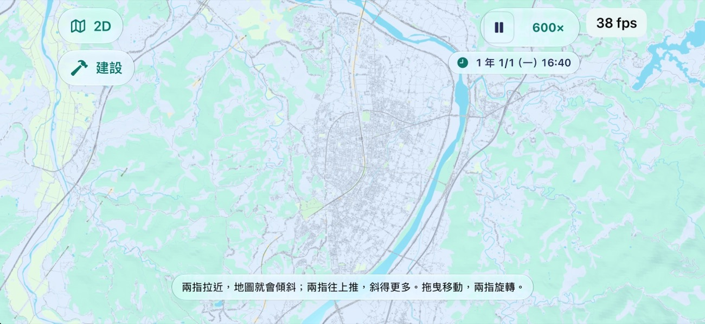
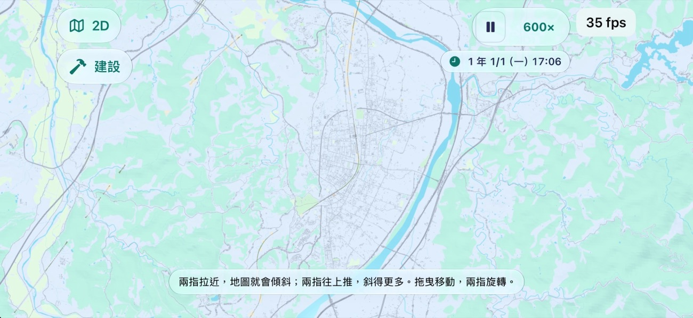
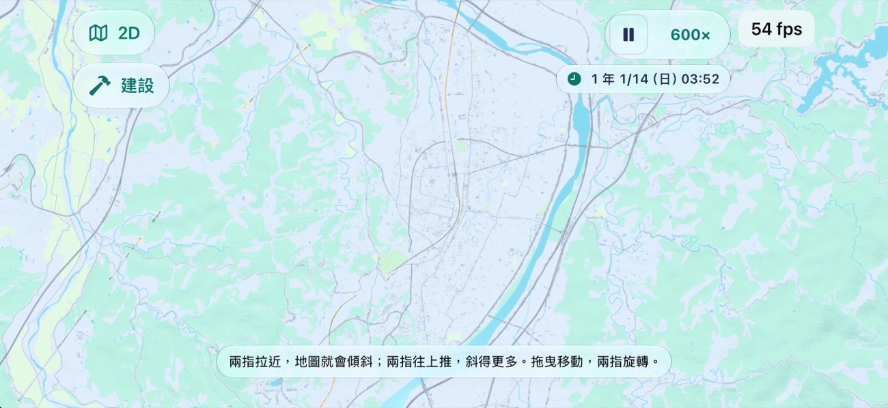
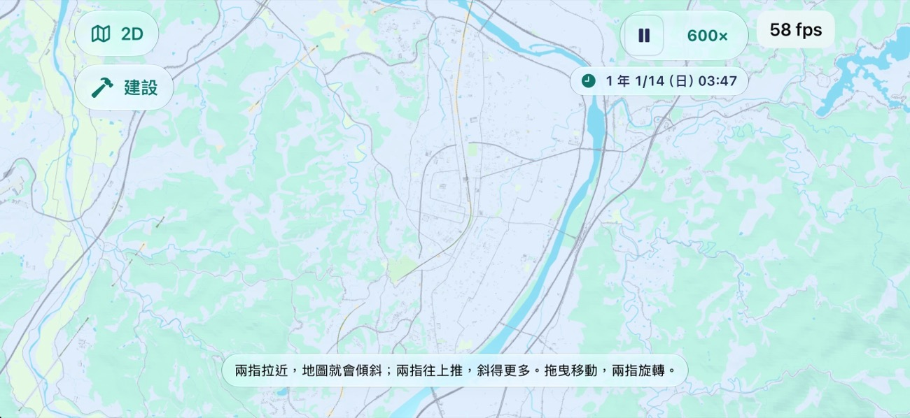
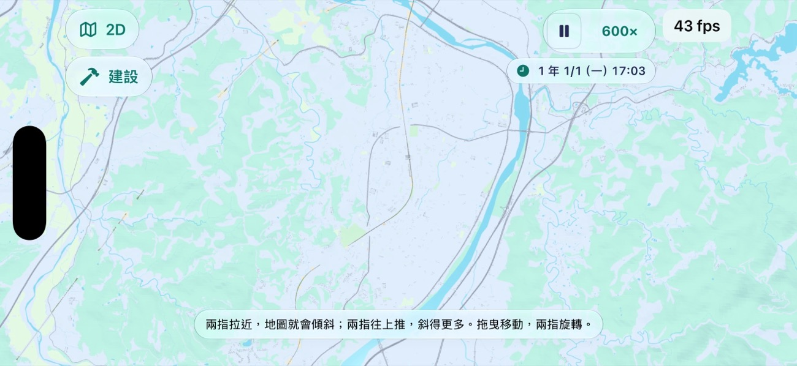

# 3D 最遠視野：實機 GPU 一格花在哪（MAP3D-FAR 第二、三件）

2026-11-13，Mac 本機 session MAP3D-FAR。iPhone 17 Pro，開發簽名 Release，存檔 B（台北，地圖 16.4 km 見方），3D 畫質設定「高」，拉到最遠（12 km）正上方看，遊戲在跑。數字是 app 自己的紀錄（`Diagnostics/frame-times.json`）每一段的 GPU 一格中位數／p95。量測用的版本是 `main` + #2116 + #2098，加只在本機的啟動參數開關（沒有推上去）；「709 關」等於今天的 `main` 加 #2116。

## 1. 結論

1. **53–58 ms 有一大半是過熱降頻。** 同一個畫面（709 關、夜間）：手機 fair 時 GPU 中位數 18.6 ms、畫面 58 fps；升到 serious 之後 58–64 ms、24–27 fps（CPU 一格也從 7 ms 變 15–21 ms）。最遠視野一開約三分鐘內就到 serious，之後停在那裡。
2. **手機的畫質設定是「高」**：這個設定照現行規則（`Map3DQuality.plan`）在 serious 仍然 60 fps、不減像素、超出也不降級，到 critical 才減像素。「自動」在 serious 會改 30 fps 並減像素。所以這支手機是在最不讓步的設定下量的。
3. **貴的是最遠視野裡 16–45 m 那幾級的東西**（小路、三級道路、中小建築），不是燈、陰影、玻璃。逐項關（都在 serious 下）：
   - 關窗燈與路燈的光暈、關太陽陰影圖、關地面陰影、關玻璃、白天對夜晚：沒有差別（都在同一次量測的波動內；白天 56.9 對夜晚 58–64）。
   - 解析度從 3 倍降到 2 倍（像素剩 44%）：62 → 43.7 ms。不開 MSAA（4 → 1）：62 → 42.0 ms。像素量占三成左右。
   - 整個靜態場景不畫（只剩天空、列車、車流）：5 ms。
   - **#2098（決策 709）照大小省**：見下表，最多省到三分之一以下。
4. **#2098 建議合**，斜率從 0.0034 改成 0.0032（最遠畫到 32 m 而不是 45 m）：郊區的鎮還看得到主要街道。已經改在 #2098。

## 2. #2098 的斜率（都在 serious、夜間、存檔 B 最遠）

| 斜率 | 12 km 最小畫到 | GPU 中位數／p95（ms） | 畫面一格（ms） | 三角形（段內最大） | 繪製次數 |
| --- | --- | --- | --- | --- | --- |
| 709 關（今天的 main + #2116） | 全部 | 63.5／75.2、62.1／82.0、58.3／69.5 | 37.5–41.7 | 3,345,845 | 1,196 |
| 0.0016 | 16 m | 63.0／73.0、60.5／71.0 | 37.5 | 2,855,978 | 1,454 |
| 0.0022 | 22.6 m | 41.6／52.0、41.7／51.7 | 29.2 | 2,131,880 | 1,494 |
| 0.0030（與 0.0032 在 12 km 同一級） | 32 m | 31.4／39.7 | 25 | 1,895,066 | 1,466 |
| 0.0034（#2098 原本的） | 45 m | 19.9／26.1、17.1／22.2、16.7／21.4 | 20.8–25 | 1,686,989 | 1,343 |

- 16 m 以下的東西去掉幾乎沒省；省在 16 → 22.6 m（小路那一級，約 20 ms）、22.6 → 32 m（約 10 ms）、32 → 45 m（三級道路那一級，約 13 ms）。
- 0.0034 時 GPU 已經不是瓶頸：畫面一格 20.8–25 ms 是 CPU（serious 下 21 ms）。
- 沒有在 fair 下量每一檔（手機一開最遠視野就升溫，等它涼要二十分鐘以上，而且量的途中又會升）。用 709 關的比例（fair 18.6 ms 對 serious 61 ms）推：0.0032 在 fair 約 10 ms、0.0034 約 6 ms，都在 60 fps 的 16.7 ms 以內；709 關的 18.6 ms 超過，所以 GPU 一直滿載、一路升溫。**這是推算，不是量到的。**

郊區（「整個臺灣」存檔，苗栗市上空 12 km，模擬器 Debug）：

| 709 關 | 0.0016 | 0.0022 |
| --- | --- | --- |
|  |  |  |

| 0.0032（選這個） | 0.0034（原本的） |
| --- | --- |
|  |  |

- 0.0034：市區只剩省道、鐵路與幾棟大建築，看不出那裡有一個鎮。0.0032：主要街道的骨架與較大的建築還在。0.0022：再多一些中型建築，實機要多 10 ms。
- 實機存檔 B（台北，夜間）：[709 關](map3d-far-2026-11-13/device-B-night-off.jpg)、[32 m](map3d-far-2026-11-13/device-B-night-slope-0030.jpg)、[45 m](map3d-far-2026-11-13/device-B-night-slope-0034.jpg)。台北 12 km 在 0.0016 是 138.5 萬三角形、972 次繪製（模擬器，[圖](map3d-far-2026-11-13/taipei-12km-slope-0016.jpg)）。

## 3. 怎麼量的、哪些不可靠

- 每一筆：重開 app（帶啟動參數）→ 讀存檔 B → 開 3D → 捏三次到最遠 → 停 8 秒 → 開始跑 → 30–33 秒 → 暫停、關 3D。取「在跑」那一段。每筆之間關掉 app 休息 75 秒。兩輪共 14 筆，全程 serious。
- 第一輪（12 筆，沒有把最遠那一段分開、沒有休息）波動太大：同一個基準前後 13.5 與 93.2 ms。只用它看方向（全部不畫 5 ms；光暈、陰影圖、地面陰影、玻璃各關一次都沒有比基準低），不用它的數字。
- 「三角形」與「繪製次數」是那一段的最大值，不是平均。
- 記憶體尖峰（app 自己記的）：14 筆在 1,695–1,881 MB，沒有記憶體警告；709 關與開沒有明顯差別。最早一次單獨量到過 2,110 MB（#2116 的留言）。
- 沒有量：iPad、低階機、「自動」畫質、fair 下的每一檔、白天對夜晚在 fair 下的差別。

## 4. 建議（沒有做）

1. **「高」畫質在 serious 也讓步**：至少照「自動」那樣改 30 fps，或打開超出預算就降級。現在它在 serious 下以 60 fps 為目標畫一格 60 ms 的畫面，只是讓手機更燙。這是畫質設定的規則（決策 417 一帶），要規劃決定。
2. **最遠視野解析度降一級**：像素量占三成；最遠時東西都小，2 倍與 3 倍的差別要實機看過才知道能不能接受。
3. **郊區的鎮在最遠視野用顏色表示**（建成區的土地利用色塊），就可以把斜率放回 0.0034 甚至更大而不會「看不出有鎮」。
4. 繪製次數（1,200–1,500）這次沒有單獨量出它占多少：709 開了之後繪製次數反而多（每塊多一兩次），GPU 卻少三分之二，所以它不是主因。
