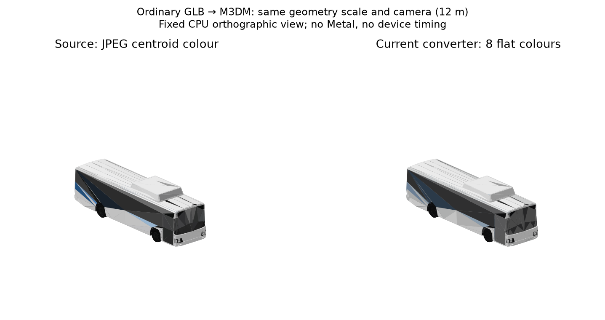
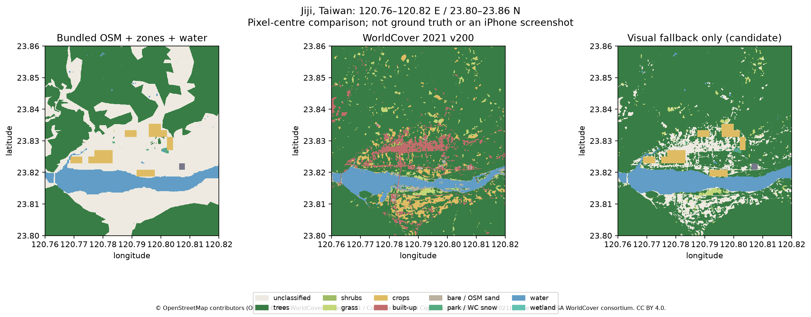

# Peakline 地圖資料與 3D 引擎研究

研究日期：2026-10-19（UTC；臺北同日）。研究者：Codex。這份交付研究、離線實驗與一個後續任務規格；沒有改正式遊戲、素材、核心規則、App 依賴或 renderer。

**建議先做一個 tools-only 的「靜態 meshopt GLB → `.m3dmodel` 橋接」**：解開壓縮、明確挑一組節點、接上非 AI 素材來源紀錄，沿用現有讀取器。現有 Metal 已有分塊、剔除、LOD、instancing 與量測；換 wgpu／Rust 不會直接補出建物或解決這次實際遇到的轉檔缺口。WorldCover 有補林地空白的價值，但需守住既有水域、農地與城市擺放語意，列為有條件候選。

2026-10-19 交叉查核更新：本檔是主報告；[#820 的補充](https://github.com/a91453/railway-game-ios/blob/cf05be2bce4e619dbc5b0cc56b830337c447e3e7/docs/research/PEAKLINE_STUDY_SUPPLEMENT_2026-10-19.md)另保存香港實際樣本、參考庫 WorldCover 流程與更多模型格式邊界，不重複完整盤點。補充基準為 `cf05be2bce4e619dbc5b0cc56b830337c447e3e7`。本次修正初版漏查的 functions 間接 LGPL 授權，新增只用五個 MIT 套件的靜態重跑證據；香港數字保留為對方環境結果，不宣稱已在本環境重現。交叉核對時remote main已到 `59b568dfcd0ebf52555778e54eb0d7921d162178`（觀光列車變更），已讀其指引／HANDOFF差異；下列小樣本與主要程式查核數據仍固定在原研究SHA，不宣稱重測新main。

## 1. 基準、範圍與證據等級

- 開始研究時由 `git ls-remote … refs/heads/main` 確認最新 main：**`43f6abc95bd4235a07f91480e401231cbf4cfe5f`**。其 commit 時間為 2026-10-19 13:24:32 +08:00；與任務書基準相同。
- 參考庫 `a91453/railway-reference-private`：**`058f8333b195d5314cc7cbd49a87aaf1869b409d`**。只取小件樣本，不搬整個素材庫進公開 repo。
- 工作分支：`codex/peakline-map-engine-study`；依 #231 登記研究檔案，存檔版本、ARCHITECTURE 決策號、golden schema 均不動。
- Linux x86_64／AMD EPYC 9V74、容器可見5個CPU；Node **22.14.0**、glTF-Transform **4.5.1**、meshoptimizer **1.3.0**、KTX-Software **4.4.2**。Python 套件版本完整保留於 [python-requirements.txt](peakline-map-engine-study/python-requirements.txt)。時間數據是單次離線階段耗時，含 JS／WASM／程序啟動的影響，不能當手機基準。

本報告使用以下區分：

| 標示 | 意義 |
| --- | --- |
| 官方／原始碼確認 | 讀過官方目錄、版本包或本 repo 程式；不代表執行過 App |
| 依賴推測 | 從套件用途推測可能的架構；未取得 Peakline 原始碼、Cargo.lock、features 或 target graph |
| VERIFIED — Linux 小樣本 | 實際跑了下載、解碼、裁切、轉檔或既有測試；成功範圍按階段列出 |
| UNVERIFIED | 未完成的下載、姿態／外觀／授權批次查核、iOS／實機效能等；沒有填入推測數字 |

Peakline 的第三方告知只能證明列名與聲明。不能由此取得它自製的引擎、shader、轉檔器或素材包的授權，也不能證明它更快、畫質更好或已推出多平台版本。

### 完整盤點入口

這些表是報告的附錄，非只列熱門候選的摘要：

| 交付 | 覆蓋／內容 |
| --- | --- |
| [附錄 C：PACKAGES.md](peakline-map-engine-study/PACKAGES.md) | C001–C141 全141筆，名稱137種；逐筆原版本、原授權表達式、原URL、角色、既有能力、結論、證據／待查；附錄A的31筆交叉索引 |
| [packages.csv](peakline-map-engine-study/packages.csv)／[packages.json](peakline-map-engine-study/packages.json) | 可機器核對的同一盤點；官方 registry 回覆的 checksum、發行日、features、授權metadata |
| [附錄 D／E：SOURCES.md](peakline-map-engine-study/SOURCES.md) | D01–D26 全26列及 E01–E04；保留原入口，另列新解析網址，未下載的版本與schema明列待查 |
| [sources.csv](peakline-map-engine-study/sources.csv)／[sources.json](peakline-map-engine-study/sources.json) | 官方入口HTTP結果、頁面SHA與逐項結論 |
| [來源包授權查核](peakline-map-engine-study/crate-package-audit.json) | 額外下載20個指定crate來源包、逐包checksum與LICENSE檔案清單 |

計數：141筆有版本套件＋25項圖資／天空資料＋1項未標版本軟體＝**167項**。D26與E01同一上游；E02–E04不是新專案。hashbrown、jni-sys、rustc-hash、syn 的兩個版本全部保留，沒有同名同版本重複列。141個指定版本的官方 registry 本次均回200、未標yanked，授權metadata字串均與任務書相符；**仍有121個包未做包內授權檔案查核**。並未建置或安裝這141個crate。

## 2. 讀過的專案規範與目前能力

先讀 `AGENTS.md`、`CLAUDE.md`、`docs/OVERVIEW.md`、`docs/HANDOFF.md`（尤其§2–4、§7.3）、`NEXT_PRIORITIES_2026-10-12.md` 的現行方向，並查 ARCHITECTURE 229、230、231、234、238、239、242、244。美術依 `.claude/skills/art-style/SKILL.md` §7：原生微縮、平塗、調色盤、淡材質；參考素材需拆件重組，公開repo不放原始參考GLB及其對照。這次未製作正式App美術。

HANDOFF §3／#729 已同意 **glTF-Transform 與 meshoptimizer 僅在 tools 使用**：固定版本、工具自己的 package.json／lockfile、README 授權記錄、不被 App／Swift 套件讀取或打包。本研究沿用這個決策，沒有重新列成未批准。初版研究的 [offline-package.json](peakline-map-engine-study/offline-package.json)／lock 保留為歷史證據，**其 functions 間接引入 LGPL 套件，不能概括在這項 MIT 授權決策內**。後續靜態橋接與重跑改用 [bridge-package.json](peakline-map-engine-study/bridge-package.json)／[lock](peakline-map-engine-study/bridge-package-lock.json)，只有 core、extensions、meshoptimizer 及兩個 MIT 間接套件；全五包 LICENSE 核對見 [bridge-license-audit.json](peakline-map-engine-study/bridge-license-audit.json)。正式工具接線留給§8。

| 已查檔案 | 本次原始碼結論／限制 |
| --- | --- |
| `tools/basemap/README.md`、`build_basemap.py`、`BaseMapStyle.swift`、`RailwayGameApp/project.yml` | 2D以MapLibre Native畫底圖；臺灣內附自製OSM PMTiles，海外OpenFreeMap。landcover含wood、grass/scrub、wetland、sand；農地由遊戲分區畫，底圖刻意沒有建物。|
| `tools/real-world-population/README.md`、`build_zone_grid.py`、`PlaceGrid.swift`、`WaterGrid.swift` | WorldPop人口、OSM地點／分區／水域、Copernicus GLO-30及局部GLO-90、Overture建蔽率已有路徑。建蔽率不是逐棟高度，魚塭在現有語意屬農業，不應被WorldCover水類覆寫。|
| `Map3DGeometry.swift`、`Map3DMetalView.swift` | 頂點**40 bytes**：position12＋normal12＋RGBA8四bytes＋texture12；Metal的color為`.uchar4Normalized`。已壓成RGBA8，加入half不能概括宣稱整體減半。|
| `Map3DMetalView.swift`、`Map3DCamera.swift`、`Map3DScene.swift` | 有分塊可見區域／視錐剔除、近／遠／最近細節LOD、模型實例、街道人車三緩衝重用。動態box、列車等路徑仍會makeBuffer，並非所有資料均已永久重用。背面剔除是另一回事：目前仍`setCullMode(.none)`。|
| `Map3DMetalView.swift`、`Map3DShaders.metal` | 有FPS、CPU/GPU幀時間median、draw-call、triangles、人車數；0.5秒彙整。現有shader為手寫MSL、日夜／霧／淡材質；不是缺少shader轉譯器才能畫地圖。|
| `Map3DRealBuildings.swift`、`CityTile.swift`、`Web/CityView/tools/pipeline/taiwan.mjs` | 高雄、臺中局部城市圖塊的輪廓＋高度／樓層＋用途→本遊戲牆／屋頂。部分樓層由足跡估計，不能稱每棟實測真高。真實建物與程序城市會讓軌道與彼此避讓。|
| `tools/glb-to-m3dmodel/README.md`、`glb.mjs`、`convert.mjs`、`jpeg.mjs`、`Map3DModelFile.swift` | 普通GLB已可離線轉檔：scene節點變換、一般accessor、部分8-bit PNG／baseline JPEG、21點烘色、最多8色、去退化面、最多15,000面。拒絕required extensions、sparse、外部圖像、progressive JPEG等。沒有meshopt／KTX2／skin姿態處理。|
| 同上來源驗證、`tools/meshy/models.json`／`generated.json` | 轉換器為Meshy試作設計：無AI識別時要求generated.json任務。一般非AI模型即使幾何正常仍會被拒絕，不能偽造AI標籤繞過。|
| `Map3DBaseMap.swift`、`Map3DRealGround.swift` | **新增地表不能只直接套舊cover入口**：`addArea`的wood／park／water也會把格子加入`taken`，影響程序城市的展示擺放。WorldCover純視覺層應避免繼承這種效果。|
| `PHASE6_LAND_USE_STUDY.md`、`MOTION_3D_TOOLS_2026-10-16.md`、`3D_DIRECTION_STUDY.md`、`MESHY_TRIAL_MODEL_SPEC_2026-10-17.md` | 既有研究已有WorldCover相關參考和離線GLB方向；本次是在現況上補實證，沒有宣稱repo從未研究WorldCover，也沒有把已完成普通轉檔器再列成待做。|

## 3. 香港模型：本環境未取得，補充研究已有實際樣本

[地政總署產品說明](https://www.landsd.gov.hk/en/survey-mapping/mapping/3d-mapping.html)區分單體化、無貼圖、由斜視航空影像生成的整片mesh。[單體化資料頁](https://data.gov.hk/en-data/dataset/hk-landsd-openmap-3d-visualisation-map-individualised-models)列MAX／FBX／GLTF。GLTF列名不保證是單一嵌入式GLB，也不保證沒有擴充、外部貼圖、地理座標或多物件；需以實際包為準。

| 發行形式 | 香港實景用途 | 精選作生成城市素材 | 相對「輪廓＋高度＋遊戲材質」的成本／價值 |
| --- | --- | --- | --- |
| D01單體化帶貼圖 | 最有機會補真實屋頂、退縮、立面與地標辨識 | 可選零件、縮面重組改色；不以香港涵蓋範圍禁止虛構城市使用 | 外形與屋頂有額外價值；照片貼圖會在8色平塗時大幅流失，不能以貼圖存在就認定值得導入 |
| D01無貼圖 | 幾何較完整但少照片處理 | 與本遊戲材質更接近，仍須分件／簡化 | 需比較幾何複雜度、是否逐物件與尺寸；尚未取得，不填面數 |
| D01整片航空網格 | 遠景展示候選 | 低：要切出單棟、清除地面／樹、修邊與重建原點 | 建物黏在地表，移動、拆除與遊戲城市避讓成本高；不當單體素材包 |
| D03 Building | 輪廓、名稱、類型、高度→輕量擠出 | 可參考尺寸與比例，缺立面資產 | 與現有CityTile路徑最接近。必查高度是相對地面或絕對標高、空值與基準，官方欄位不代表全棟齊備 |
| D02 3D-BIT00 | 建物、基礎設施與地形；L1適合量體 | L2/L3地標可另挑 | 官方說L1由足跡拉高、不貼寫實照片；L2/L3地標有照片貼圖，L3另參考建築圖。不是每棟完整寫實模型 |

以上不能提供臺灣原地的真實建物。臺灣現有輪廓來源與局部城市流程仍較合適；本研究沒有延伸購買臺灣官方3D批次，也不概括所有政府3D資料都免費或不能商用。

### 本次取得嘗試

VERIFIED — Linux：讀取官方[下載API](https://3d.map.gov.hk/mapviewer/app/download-api?l=en-US)、圖幅索引、[模型大小CSV](https://3d.map.gov.hk/mapviewer/app/grid/INDIVIDUAL_MODELS_DATA_SIZE.csv)。API以format與1:1000圖幅選包，單體化不等於可逐棟網路下載。官方示例`11-NW-10B`在清單的GLTF約**5,723.7 MB**，因此未下載；另找出`10-SW-19C`約**2.4 MB**做小樣本候選。

實際查詢公開下載流程產生的`https://data11.map.gov.hk/api/3d-zip/GLTF/10-SW-19C.zip`（參數值不寫入repo）回 **403、199 bytes、HTML**，不是ZIP；原download主機的示例查詢也回403。目錄與CSV可讀不等於模型可取得。[hk-acquisition.json](peakline-map-engine-study/hk-acquisition.json)保留無敏感參數的結果。**沒有取得香港模型**，故資料版本、實際模型授權包、CRS／單位、原點、朝向、單棟操作、面數、轉檔、外觀與手機效能均UNVERIFIED。403的根因未確定，不宣稱資料全球不可用或必須付費。

### #820 補充的實際樣本（非本環境重跑）

[補充§2](https://github.com/a91453/railway-game-ios/blob/cf05be2bce4e619dbc5b0cc56b830337c447e3e7/docs/research/PEAKLINE_STUDY_SUPPLEMENT_2026-10-19.md#2-香港單體化模型其實拿得到)記錄同日由無金鑰的 `download.map.gov.hk/api/3d-zip/{格式}/11-NW-10B.zip` 取得 2026-07-17 修訂批次：GLTF0 ZIP **43,394,698 bytes**；帶貼圖 ZIP 的 Content-Length **861,053,392 bytes**，並用 HTTP Range 只取一棟四檔 **171,507 bytes**。CSV的5,723.7 MB與ZIP長度不同，不能當作實際下載量；選樣前應查實際 Content-Length／Range。對方已取得不推翻本環境的403記錄；本環境對該無金鑰路徑仍回403，根因未定。

補充的無貼圖圖幅含161棟、102,541面，中位353面、最多4,964面；每棟是 `.gltf`＋外部 `.bin`，帶貼圖另有JPEG／PNG，未用glTF擴充。三件轉檔樣本為351面／1色／18,652 bytes、同棟帶貼圖351面／8色／18,676 bytes，以及高樓4,964面／258,528 bytes。外形增加退縮與屋頂細節；照片窗格在平塗後明顯流失。無貼圖建物全部、貼圖建物105面被現有中性色啟發式誤當塗裝，說明「轉成功」仍需一般建物的材質策略。以上為 **#820 Linux樣本證據**，模型／CRS／轉換時間未在本環境獨立重跑。

補充的原converter測試使用scratch `generated.json`來源佔位資料，因此只證明幾何／烘色路徑；**正式非AI來源接口仍未完成**。外部 `.gltf` 打包、HK1980方格座標／公尺／高程及z-up→y-up矩陣、一般建物關閉塗裝猜測，列為日後建物接線條件，不擴大§8的靜態GLB任務。下載API頁另指向 LandsD Map API 條款，含圖面標誌／copyright與呼叫限制；散布前需核對實際取得路徑，不能用CSDI總條款替代。詳見補充§2.4；本研究沒有散布香港原始模型。

取得後需先驗：CRS／垂直基準→轉局部公尺、HK網格或地心座標→遊戲座標、是否Z-up／Y-up、節點矩陣、單棟選取與貼圖URI，再測幾何／貼圖／簡化／烘色。不要對地理模型直接套公車的「長12m、重置地面」邏輯；絕對海拔和底高分開保存。

## 4. GLB 小樣本：成功階段與失敗階段分開看

樣本來源與原始SHA、尺寸、數量、時間見 [glb-metrics.json](peakline-map-engine-study/glb-metrics.json)、[reference-bake.json](peakline-map-engine-study/reference-bake.json)、[ktx-metrics.json](peakline-map-engine-study/ktx-metrics.json)。普通公車已存在公開repo；兩個原始參考模型、加工腳本及對照留暫存／私有交付，沒有提交公開repo或進App。

### 4.1 對照：目前可轉的普通GLB

`docs/art/meshy-city-bus-2026-10-18/city-bus.glb`，來源紀錄沿用該README及Meshy任務，不另花點數／不呼叫生成服務。原檔 **2,208,860 bytes、1,988個POSITION元素、1,545面、1材質、1張2048² JPEG**，沒有required extensions。長軸x、y向上、車頭−x；原座標約0.954長，工具依既有manifest改為12m，不把原數值誤當12m實體尺度。

VERIFIED — Linux：原工具直接輸出 **1,543面、8色、81,636 bytes**，移除2個零面積面；輸出車頭+x、底z=0。一次轉換約 **599.3 ms**，夜光面0；這是來源沒有獨立燈材質的限制。4個既有Node測試全通過。檔頭保留來源／AI任務與原始SHA。



兩側同為12m、正交相機elevation22°／azimuth−40°的CPU三角形預覽；左側以JPEG三角形中心取樣，右側為現有21點取樣後8色輸出。不是PBR原圖／Metal／手機畫面。輪廓和窗帶留下，但窗門的貼圖細節會變成大面色塊；「8色」也不等於已映射到遊戲固定Palette，這仍需素材美術步驟。

### 4.2 實際想用的靜態壓縮參考

參考庫`Railway/street_scene_reference_clean/source/models/street-agents.glb`：原 **823,224 bytes、213 meshes/nodes、124材質、24,424個POSITION元素、21,878面**。`extensionsUsed`／`Required`都只有 **EXT_meshopt_compression**，沒有圖片、KTX2、量化擴充、骨架或動畫。與舊研究中某些角色含三種擴充的情形分開，不能籠統認定所有參考GLB相同。

| 階段 | 本次結果 |
| --- | --- |
| 現有工具直接讀原檔 | 明確拒絕required EXT_meshopt_compression；沒有繞過檢查 |
| 官方meshoptimizer解碼 | **全623個buffer view成功**；622個ATTRIBUTES header `0xa0`、1個TRIANGLES `0xe1`，未使用額外filter。原壓縮payload509,535 → 解碼863,684 bytes；完整213-mesh普通GLB為1,043,372 bytes。解碼整份約29.4 ms（精確值見JSON） |
| 挑出可獨立操作的單件 | 明確選12個`bus__`元件、prune未用資源；3,007 POSITION元素、2,488面、12材質、無貼圖。原12件都是identity節點變換，選整組才是一台車，不能只取body就稱完整模型 |
| 座標與朝向 | y-up、長軸z；頭燈平均z約+6.04、後部約−4.40，據此選front=+z。原尺寸約3.230寬×4.415高×12.150長，比例符合公尺車體但無獨立測繪單位證明；實驗明確指定長12m、居中、底z=0 |
| 解碼後接原轉換器 | 幾何與材質取樣已走過，但最終拒絕：`No AI identification … no generated.json tasks`。這是真正的非AI來源接口缺口 |
| 暫存來源接口實驗 | 僅在scratch複本替換provenance函式，保留asset／SHA並明寫非AI、研究用途，不偽造Meshy任務。輸出 **2,488面、7色、129,700 bytes**；約90.7ms。不是主工具已支援，也不是正式採用該模型 |
| 減面 | 官方`weld → simplify(ratio=.5,error=.01) → prune`：2,488→**1,391面**，1,752 POSITION元素；約14.2ms。目標不是保證，未硬湊到1,244面。簡化GLB60,568 bytes；烘色輸出 **72,656 bytes、8色**、約24.3ms |
| 已知外觀限制 | 固定相機對照已在Linux看過；輪廓留下，簡化後輪胎／飾條變粗，黑色窗面仍很強。保留的是原造型與原材質色，不是已完成拆件重組及遊戲Palette美術驗收。名稱猜燈把部分面當夜光，112→80面，尚未夜景驗證 |

原始比較圖留`/workspace/scratch/peakline-study/reference-comparison-private.png`，不提交公開repo，遵守HANDOFF §3與art-style §7的原始素材對照規則。圖以相同12m、相同CPU正交相機比較解碼前後及減面版本；可用本次交付的暫存重現包在有參考庫權限的環境重建。沒有把單純改色縮面當成可直接入App的美術成品。

**大小不能混比**：823,224→97,044 bytes的「單台解碼GLB」同時刪掉其餘201個mesh，不能宣稱是壓縮率改善。公平的完整同內容檔案比較是823,224→1,043,372。`.m3dmodel`展開成平塗GPU頂點時，每面3×40B：2,488面為**298,560 bytes**、1,391面為**166,920 bytes**；普通公車為185,160 bytes。這是按現行reader布局計算的vertex payload，不含其他場景、緩衝配置與實例，**未在GPU實測配置或幀時間**。

### 4.2a 排除 functions 後的靜態重跑

VERIFIED — Linux／Node22.14.0：在乾淨scratch安裝 `bridge-package.json` 的三個直接依賴，`npm ls --all`只有五包；逐包讀到MIT許可正文並記LICENSE SHA。只用core／extensions／meshoptimizer解碼，同樣明確挑12個`bus__`節點，以本樣本的引用集合清理未用mesh／accessor／material，沒有import functions。普通GLB **118,988 bytes**；再經同一scratch非AI來源函式，M3DM **129,700 bytes、2,488面、7色**，其 **129,376-byte三角形payload與§4.2原實驗逐byte相同**。檔頭來源SHA因中介GLB編碼不同而變，沒有宣稱整個M3DM hash相同。數據與SHA見 [bridge-replay.json](peakline-map-engine-study/bridge-replay.json)。

這只驗證靜態、無貼圖樣本，不是通用prune實作；§4.2減面與§4.3反量化仍是原含functions環境的歷史數據，未在此新環境重跑。後續若要減面可另試同一MIT套件的`MeshoptSimplifier`，但不納入§8第一版。

### 4.3 額外邊界樣本：量化、KTX2與skin

參考庫`Railway/city_world_reference/source/avatars/casual-m.glb`，**197,624 bytes、2,493 POSITION元素、3,710面、1材質、3張KTX2、1 skin、0動畫clip**。三個required擴充為EXT_meshopt_compression、KHR_mesh_quantization、KHR_texture_basisu。asset聲明Microsoft Rocketbox衍生與MIT；參考庫NOTICE明說原授權檔未隨快照保留，**實際採用前須補齊上游授權／來源記錄**，不能僅靠嵌入一行copyright宣告通過。

VERIFIED — Linux：

1. 官方工具解開幾何約11.9ms；`dequantize`約2.4ms，POSITION由5122整數轉5126 float。保留節點階層；靜態bounds為x ±0.7192、y ±1、z ±0.1986，這是bind/reference幾何邊界，沒有驗證實際角色姿態或遊戲單位。
2. 去掉已解碼的meshopt與已正規化的quantization後，普通GLB314,364 bytes；原工具仍正確拒絕required KHR_texture_basisu。
3. KTX-Software4.4.2 `ktx extract --transcode rgba8`各取level0：色圖1536×512→PNG352,133 bytes／342.9ms；法線384×128→40,989／50.6ms；遮罩192×64→10,029／32.2ms。都是8-bit PNG，色圖RGBA，其餘RGB。三張轉碼成功，並不代表所有mip、材質或glTF功能都處理完。
4. 換成PNG、移除已被替代的basisu擴充後GLB562,908 bytes，現有取樣／三角形流程可走到來源驗證，再因非AI紀錄被拒絕。**沒有輸出通過驗收的`.m3dmodel`**：既有converter不處理skin／inverse-bind／pose；不能靠忽略骨架生成一個外觀錯誤的靜態人，再報完整成功。未做此件減面／動作驗證。

現有flat材質只讀base color及少量發光判定，KTX法線／roughness／mask即使轉出，也沒有對應的PBR runtime路徑。KTX-Software是額外暫存研究工具，不是這次推薦任務或App新依賴；其專案包含不同授權與特殊檔案條款，見§7，不能只以總README的Apache標籤概括整包。

### 4.4 codec相容性結論

E01只聲明Peakline移植解碼器支援index0/1、vertex0，未標套件版本。這次靜態參考的e1/a0落在該聲明範圍，但**未取得其Rust程式，不能替它實測**。本次用官方meshoptimizer1.3.0的JS/WASM解碼器，無需先引Rust或換renderer。

[1.3 JS文件](https://github.com/zeux/meshoptimizer/blob/v1.3/js/README.md)明載：新`encodeVertexBuffer`預設vertex v1；EXT_meshopt相容編碼需v0，`encodeGltfBuffer`預設v0。三點小探針產出的a0為67 bytes、a1為37 bytes，本次新解碼器兩者都能無損round-trip；這不是整件GLB測試，也沒有證明Peakline的vertex0解碼器可讀a1。正式工具要固定版本、檢查extension與codec，不把「上游解碼成功」擴張為全部glTF支援。

## 5. WorldCover：集集同範圍資料比較

資料直接取ESA公開S3：**WorldCover2021 v200／N21E120 Map**。產品是全球約10m、11類、EPSG:4326分類柵格；不是高程、逐棟建物或法定土地用途。[官方資料與授權](https://esa-worldcover.org/en/data-access)

VERIFIED — Linux：範圍 **120.76–120.82°E／23.80–23.86°N**，集集聚落、農地、山林與濁水溪，約40.81km²。對照直接讀**這個基準commit打包的**z14 PMTiles（16塊），按本專案cover順序、切除tile buffer重疊；另以`PlaceGrid`的7.5″分區、16點中至少半數門檻及tie順序，與`WaterGrid`的1.875″水域做像素中心取樣。不是以今天的新OSM替換基準，也未走Overpass。原始OSM資料時間分別在2026-10-06／10-08，檔案SHA見JSON。

這是地理分類比較，**不是某個存檔或App的逐像素截圖**：未加入道路、建物／地標、軌道與遊戲城市細節。白色代表這組landcover＋分區＋水域圖層未分類，不代表遊戲畫面一片白或現實沒有植被。



### 實際看到的空缺與衝突

完整交叉表及精確整數見 [worldcover-metrics.json](peakline-map-engine-study/worldcover-metrics.json)。720×720共518,400個分類像素；其中WorldCover tree411,169、grass13,500、crops24,612、built-up29,477、bare5,440、water34,202。此區無其餘類別，不替全球11類填假樣本。

- 原有林地面之間、聚落北側及溪南側有未分類帶。WorldCover能在原分類空白補出樹木／草地連續性；候選規則「既有分類空白且WC為tree/shrub/grass/wetland/mangrove/moss」補**159,646像素，約12.57km²**。這是候選補色面積，未經現地／同期航照確認，不稱新增真實森林精度提升。
- WC農地24,612像素中**22,089不在既有遊戲農地分區**。有的可補地表配色，但不能因此新增農業就業或改分區；果園也可能被WC分成tree，分類語意不同。
- **2,413個WC水像素落在遊戲乾地**；**12,620個遊戲水域像素被WC分成非水**，包含河岸樹草、裸地等。年度水位、河床與混合像元都可能造成差別，未判定哪一方較真。候選視覺mask改到既有水域0像素、既有分區0像素。
- 2021距研究日約5年，新增聚落、開發、河道與耕作變化都可能過時；樹／作物、人工地表／裸地、濕地邊界分類也會錯。官方全球整體精度不是這40.81km²的實測精度，故不拿全球數字替本區驗收。

圖中右側只是離線候選合成。未遮罩道路、現有建物／軌道的候選面積屬上限；實作樹木前必須另排除它們。尤其現有`addArea(.wood)`會拿走程序城市展示地塊，不能把所有候選樹類直接塞入該入口，讓有城鎮的地方被樹林遮掉。

### 可重用的參考庫流程與區域結論限制

交叉查核[#820補充§3](https://github.com/a91453/railway-game-ios/blob/cf05be2bce4e619dbc5b0cc56b830337c447e3e7/docs/research/PEAKLINE_STUDY_SUPPLEMENT_2026-10-19.md#3-worldcover參考庫已經做好而且空缺在平原)後，已直接讀同一參考SHA的 `Railway/taiwan-rail-reference-clean/source/scripts/build_worldcover.py`、`verify_worldcover_data.py`、`rail-3d/landcover/worldcover-2021/manifest.json`及兩篇landscape／WorldCover說明；檔案SHA與manifest摘錄見 [supplement-review.json](peakline-map-engine-study/supplement-review.json)。這是初版參考檢查漏列的現成路徑。產生器由四塊官方COG、內政部1140318縣市界海岸mask、最近鄰256²分類與拓撲簡化輸出MVT。manifest記 **z6–11共918塊、276非空、22,967,839 bytes、最大391,261 bytes，近景約70m**；並保留WorldCover CC BY4.0與海岸來源政府資料開放授權。這是**參考成品既有容量**，不是目前App的包體增量，也不是已在本專案跑過全臺製程。後續優先轉接／裁切這條路徑，不重寫已有切圖器；仍須處理本專案mask與`taken`語意。

補充兩樣區的WorldCover樹木與OSM林地交集為宜蘭29.2%、平溪94.3%，說明收益隨區域不同；本報告的集集樣本也有林地空缺。**不能由這三區推定全臺「空缺只在平原」或「山區已完整」**。補充比較器取OSM z13、未裁tile buffer，分區各自用門檻判斷；本比較取App 3D使用的z14、裁tile邊界並解分區majority／tie。因此數字只各自支援其樣區，跨區排序或精算收益前須統一取樣口徑。兩者均未以同期真值驗證分類準確率，也未證明遊戲畫面更好。

### 建議映射與最小整合位置

| WorldCover類別 | 外觀／植被候選 | 保留的現有語意 |
| --- | --- | --- |
| 10 trees | 遠景林地調色；近景稀疏樹冠候選 | 避開OSM既有分類、道路、軌道、建物與所有遊戲分區；不當樹種／單樹高度 |
| 20 shrubland、30 grassland | 草／灌叢地色，降低樹密度 | 不視為可建造／保育地法定分類 |
| 40 cropland | 只在日後確認需要時補淡色田地視覺 | 不寫PlaceGrid分區，不產生農業工作，魚塭維持現有語意 |
| 50 built-up | 本次不補；可作排除植被參考 | 不生成逐棟建物、不改人口／密度 |
| 60 bare、70 snow/ice | 低優先色層候選；需區域判斷 | 不把bare全部視為沙灘，臺灣本區無雪樣本 |
| 80 water | 只當差異診斷，本次不導入 | 海岸、水面、橋隧及建造判斷仍以既有水域／DEM |
| 90 herbaceous wetland、95 mangrove、100 moss/lichen | 濕地／低矮植被視覺；後兩類本區未測 | 不改水域或可建造格 |

**最小方式是僅補遠景視覺缺漏**，較全面植被生成小。離線mask輸出後，以可撤回的展示資料接`BaseMapStyle`及3D地面；不讓其進`GameCore.terrain`、`LandImport`或分區決策，也不直接使用會填`taken`的舊wood處理路徑。需要同時檢查2D與3D一致性及城市擺放；因此本次不把它選成下一個最小任務。

### 裁切、重採樣與成本

本區只需一個3°圖幅。因rasterio／GDAL遠端讀取在此環境遇CA驗證失敗，本次保留TLS驗證，改由環境正常HTTPS信任路徑下載**22,768,220 bytes**的官方單圖幅，再本地裁切；沒有下載全球117GB。來源ETag、Last-Modified與裁切資訊見 [acquisition.json](peakline-map-engine-study/acquisition.json)。

- window `[9120,1680,720,720]`；原始uint8分類518,400 bytes，DEFLATE GeoTIFF **30,496 bytes**、一個檔。裁切本地約0.024s；分類對照、mask、重採樣與輸出圖約4–5s，未當成網路下載耗時。
- 做120×120個6×6像元的多數分類（約50–56m、非精確64m），tie取較小類號：raw14,400 bytes、一個檔；回展後與10m分類差42,504像素（8.20%）。這是重採樣差異，不是準確率。不能對class ID做雙線性平均。
- 正式整合若對齊遊戲64m地面，還要按實際投影／anchor重採樣；不能把0.0005°稱固定64m。全臺容量與處理時間本次未量，不由這一區線性外推承諾。

## 6. 引擎與配套套件的取捨

附錄C每列有角色；以下共用技術分析不增加候選數。

| 功能群 | 可解決的問題 | 本專案適用條件／成本 |
| --- | --- | --- |
| R15 wgpu 30.0.1／core／hal／types／naga-bridge及Apple、Windows-Linux-Android依賴包 | 跨平台GPU API與backend堆疊 | 是同一堆疊不同層。若有確定跨平台產品方向才值得估。現有Swift場景資料需FFI／buffer生命期同步，Metal pipeline、shader、MTKView介面與量測要重接；不是加一個crate就遷移完成。未做wgpu build／iOS原型或效能比較。[官方repo](https://github.com/gfx-rs/wgpu) |
| R14 UniFFI 0.32.2及8個組件、weedle2 | Rust模組對Swift等語言產生接口 | 先有確定Rust模組才需要。bindgen／UDL／meta／pipeline／macros多屬建置，core含runtime；生成Swift wrapper不會將既有Swift引擎改寫成Rust，頻繁跨FFI與大陣列拷貝仍需設計。[Swift bindings](https://mozilla.github.io/uniffi-rs/latest/swift/overview.html) |
| R13 naga／naga-types、spirv | shader解析、驗證、IR、轉譯 | 現有手寫MSL可由Apple工具編譯。Naga的常用WGSL／GLSL／SPIR-V輸入與MSL輸出不能被寫成「自動將既有MSL反向轉換」；跨平台shader才有明確價值，不生成地圖／模型。[30.0.1文件](https://docs.rs/naga/30.0.1/naga/) |
| R8 objc2系列、raw-window-metal／handle、block2／dispatch2 | Rust與Apple物件、Metal layer、原生視窗與dispatch連接 | Swift的MTKView、Metal、Dispatch已直接提供對應能力；只有Rust邊界才需此層，先改寫現有Apple路徑沒有直接畫面收益。[objc2-metal文件](https://docs.rs/objc2-metal/0.3.2/objc2_metal/) |
| R12 profiling、renderdoc-sys、log | CPU／GPU追蹤與診斷 | 已有FPS／幀時間／draw-call。先固定存檔、鏡頭、時間、天氣、streetDetail與裝置，讓現有數據可匯出，量scene build、buffer bytes、p50/p95；深入iOS GPU再用Metal debugger／Instruments。Rust profiling scope本身不會為Swift函式插樁。[profiling](https://github.com/aclysma/profiling)、[Apple分析工具](https://developer.apple.com/documentation/xcode/analyzing-the-performance-of-your-metal-app/) |
| R9 half、bytemuck／derive、zerocopy／derive | 緊湊數值表示、POD驗證、零拷貝安全 | 可借資料布局概念；Swift／Metal也有Float16／half。先量局部座標誤差、法線／UV量化、alignment及shader輸入，不為crate引Rust。40B中RGBA已只有4B；即使把36B浮點全改成18B，未對齊理論仍22B且不保證全可改，不能稱總量減半。[half文件](https://docs.rs/half/2.7.1/half/) |
| R2 smallvec／arrayvec／hash表／allocator／數值與初始化 | 小容器配置、集合及數值支援 | 先量配置熱點；Swift現有Array／Dictionary與預配置可做相同類型改善。更快與否取決於資料分布和操作，清單沒有性能證據 |
| R10 gpu-allocator／presser、R11鎖與scope guard | backend記憶體／同步安全 | 是Rust／backend內部配套。現有MTLBuffer、鎖與街道三緩衝已有能力；CPU資料生成與GPU瓶頸要分測 |
| R1解壓／checksum、R7 serde／JSON／TOML／parser／文字數值 | 格式、設定與壓縮配套 | Swift Codable與Node/Python已有對應；DEFLATE不是meshopt或Basis解碼，不補新的圖資功能 |
| R3系統／Android／Vulkan／EGL／Wayland，R4 CLI，R5錯誤，R6巨集／模板／Cargo metadata | 平台、建置、工具及間接支援 | 全部保留逐列用途；不能拿Android/Vulkan/Linux名稱證明iOS正在使用該backend，或拿syn／quote等當地圖功能候選 |

只能**推測**Peakline可能有Rust核心、UniFFI接口及wgpu的Metal路徑；它的實際模組界線、features、使用哪些演算法及效能均未查得。這次不採用其Rust移植，直接用有官方文件與版本鎖定的離線工具驗證需求。

## 7. 主要候選比較與授權

| 候選／優先 | 解決現有問題／已具備部分 | 缺口與整合位置／成本 | 授權／實證 |
| --- | --- | --- | --- |
| **1 優先試作：靜態meshopt離線橋接** | 壓縮參考被拒；已有普通GLB→M3DM與原生reader | tools內解碼、節點選取、非AI provenance；小。資料格式／renderer不動 | core／extensions4.5.1、meshoptimizer1.3.0及間接兩包共五包MIT；無functions靜態重跑通過；正式主工具接口未做 |
| 2 有條件：WorldCover遠景補漏 | 有OSM覆蓋，但集集存在未分類帶 | 離線視覺mask＋2D/3D展示接線；中。避免taken、道路、城鎮、water／zones | 2021 v200、CC BY4.0、免費；本區比較通過，非真值精度或實機驗收 |
| 3 有條件：香港Building／3D-BIT00 L1 | 香港實景量體；已有擠出器 | 選批次、CRS／高度語意→CityTile類似中介；中 | 官方頁可確認用途；未下載schema／版本／條款包，不當已可打包 |
| 4 有條件：香港單體化／無貼圖精選 | 地標外形或生成城市幾何細節 | 分件、重組、LOD、材質改寫、原點；中到高 | 本環境下載403；#820已取得兩種樣本並烘色，暴露塗裝誤判及細節流失；實際路徑條款需另核 |
| 5 暫緩：整片攝影mesh／全城素材 | 遠景實景 | 地面切分、單棟獨立操作、城市避讓、容量；高 | 未取得樣本；不能以城市目錄的GLTF標籤當作現成遊戲素材 |
| 6 有條件但暫不接：KTX2／量化／角色skin | 複雜參考素材 | 幾何、貼圖、pose及來源是四個獨立問題；高於靜態橋接 | 本次三張KTX2轉PNG與反量化通過；skin未通過完整輸出驗收，授權檔亦有缺口 |
| 7 暫緩：wgpu／UniFFI／Naga遷移 | 未來跨平台renderer／Rust模組 | 現已有Metal／Swift；遷移成本高，沒有手機對照數據 | wgpu指定包MIT OR Apache；UniFFI MPL2.0；不是本次地圖素材工作的前置 |
| 低優先：D04–D21其他香港地物、D24/D25天空 | 香港詳細地物或天文效果 | 無香港實景／精確星空需求時收益小 | 逐項入口、型態、範圍與待查保留附錄D，未展開大下載 |

### 依實際版本處理的條款

- **香港CSDI**：[條款](https://portal.csdi.gov.hk/csdi-webpage/doc/TNC)§3允許依條件免費商業／非商業下載、重製、散布等，須在副本清楚標政府與CSDI來源、承認相關權利，並有免責及賠償條款。這不是把資料改成CC0。所選模型未下載，修改／派生素材的具體包內附加條件仍待查；進App前保存版本、原始告示、修改記錄及credits。地政總署一般產品頁也保留HKMS價格／訂購說明，不能把CSDI免費路徑擴大到所有批次／平台／服務均無費用。
- **WorldCover2021 v200**：官方頁與[CC BY4.0](https://creativecommons.org/licenses/by/4.0/legalcode.en)允許商用、修改、分享；保留作者／來源／授權連結及修改說明。圖中及本報告保留「© ESA WorldCover project 2021 / Contains modified Copernicus Sentinel data (2021) processed by ESA WorldCover consortium. CC BY 4.0.」本次修改為裁切、分類mask、多數重採樣與繪圖；若日後進App，再把同等資訊加`DataSourceCredits`。
- **OSM**：既有底圖與分區來源持續標OSM contributors／ODbL；本次分類比較未用Peakline重製資料庫。Produced Work圖像與衍生資料庫的散布義務須分開，不以截圖署名替代實際資料的ODbL處理。[官方copyright](https://www.openstreetmap.org/copyright)
- **meshoptimizer1.3.0／glTF-Transform4.5.1**：直接包為MIT，但初版僅查直接包而漏掉 `functions → ndarray-pixels5.2.0 → sharp0.35.5 → @img/sharp-libvips-*1.3.4` 的LGPL-3.0-or-later；歷史lock也列含LGPL的wasm條目。這項漏查已修正：原lock／減面與反量化量測照實保留，不再推薦安裝該環境或將其視為§3的MIT決策已涵蓋。LGPL不等於禁止商用或要求整個獨立遊戲開源；此處按repo未同意重用copyleft的規則，縮到不含functions的路徑即可完成最小任務，不另增批准流程。新bridge lock的core／extensions4.5.1、meshoptimizer1.3.0、property-graph4.1.0、ktx-parse1.1.0全五包已查MIT正文與SHA，見bridge-license-audit.json；散布程式仍須保留版權／許可。這不授權輸入模型。正式tools沿固定版本／lockfile／README告示。
- **wgpu30.0.1／Naga30.0.1**：下載相關來源包，checksum相符，讀到MIT及Apache授權檔；實際選用時可依雙授權擇一、保留適用告示與NOTICE／修改要求。各平台間接依賴另有自己的條款；這份沒有把同repo全列一概改授權，也未把crate加進App。
- **UniFFI0.32.2**：8個來源包的Cargo.toml／registry宣告MPL-2.0；包內未找到獨立LICENSE，另核官方tag `v0.32.2`（`7bc621ee9d0d15371d792612707ba5ed4111f950`）的LICENSE。[MPL FAQ](https://www.mozilla.org/en-US/MPL/2.0/FAQ/)說明檔案範圍的義務；散布受涵蓋可執行碼時需讓接收者能取得對應Source Code Form並告知取得方法，保留授權告示，修改受涵蓋檔案須依MPL提供。可與獨立的閉源遊戲組成Larger Work；**未修改不等於沒有告知／原始碼提供義務，也不要求整個獨立遊戲開源**。只在內部跑產碼與實際散布runtime／受涵蓋產物的情形應分查。沒有複製MPL程式進本專案。
- **weedle2 5.0.0**：實際crate的LICENSE.md是MIT；共用UniFFI repo不改變C129原授權。**unicode-ident1.0.26**包有Unicode授權檔，保留`(MIT OR Apache-2.0) AND Unicode-3.0`，不能漏掉AND條件。
- **KTX-Software4.4.2**：僅下載官方7,375,900-byte Linux包供暫存轉碼；SHA見acquisition.json。[版本LICENSE](https://github.com/KhronosGroup/KTX-Software/blob/v4.4.2/LICENSE.md)說明本專案多數獨有檔Apache2.0、另有多個第三方授權，並列`lib/etcdec.cxx`的Ericsson特例。因此不把完整工具或二進位再散布進repo／App；若後續需要正式納入，另查實際binary及其依賴、LICENSES與NOTICE。這不影響已同意的兩個MIT專案。
- **E03／E04**的ISC／Apache文字按附錄E保留；Jonas聲明尚未可靠對應crate，不能因位置就套給libloading。本報告不是最終App第三方告知檔，後者必須按真正打包的依賴生成。

## 8. 只推薦一個接著實作的最小任務

**任務：在既有離線工具前接「可追溯的靜態meshopt模型橋接」，先限無貼圖、無skin／動畫的三角形模型。** 這是研究後的建議規格，本次沒有把它實作進正式工具。

### 範圍與位置

1. `tools/glb-to-m3dmodel/`新增一個顯式前處理入口和小型manifest：input／節點名白名單／front／length或單位策略／來源URL或私有引用／版本SHA／授權與署名文字。輸入EXT_meshopt以官方decoder解開後產生普通GLB；保留節點矩陣，不只複製POSITION。固定`@gltf-transform/core`／`extensions`4.5.1與meshoptimizer1.3.0，**不加functions**；以本報告bridge lock的五個MIT包為起點，工具自己的package.json、lockfile及README授權記錄。節點引用清理使用core API，不為prune拉入影像依賴；第一版不做反量化。
2. `convert.mjs`增加**非AI來源紀錄接口**，保留既有Meshy驗證；非AI支路不捏造generated.tasks、不寫aiGenerated=true。兩支路都要求可追溯來源，輸出既有M3DM v1，無需改`Map3DModelFile`。
3. 邊界明確：第一版只處理EXT_meshopt與普通色材質，未知required extension、量化／KTX2、外部資源、skin／animation／morph等未支援語意明確拒絕。減面在此次研究證明可行，但**不列進第一版任務**；先讓可選的靜態模型可靠進現有格式。
4. 測試放`tools/glb-to-m3dmodel/`；用本專案自製、無第三方素材的壓縮fixture測變換／節點選取／錯誤邊界。實際私有參考樣本只在本地重跑，不把原檔或改名原檔當fixture提交。README補命令與接手點，HANDOFF更新一小段。

### 驗收

- 既有普通公車與tiny fixture的輸出逐byte不變，4個原測試仍通過。
- 自製fixture與未壓縮對照在套用節點矩陣後，數量、bounds、顏色、front與底高一致；來源SHA／授權／非AI分類均在檔頭可讀。
- 以本次靜態參考挑出的12件模型跑端到端，普通GLB與新入口產出的M3DM一致；目前主工具的非AI拒絕確實被合法來源支路取代，原本缺來源者仍拒絕。
- 未支援skin／KTX2／量化／外部圖像及未知required擴充時，在輸出前給可操作錯誤；失敗不留下半個可用模型。不刪required宣告來假裝支援。
- `.m3dmodel`由現有Swift reader讀入的檢查若執行，只用Swift6.4，標明Linux；不改App依賴、正式素材、renderer、GameCore、存檔或golden。工具不被App／Swift套件或Xcode資源規則打包。
- lockfile完整依賴樹與實際安裝包授權均查核，維持五個MIT包；不得以只看直接包授權替代。
- 此任務完成不等於模型美術採用或手機效能通過；素材拆件重組／Palette與同場景實機量測仍屬後續採用關卡，不在工具PR偷渡正式素材。

### 撤回

移除新的前處理入口、manifest、npm檔和非AI來源支路即可回到原本Node標準庫轉檔。格式仍是M3DM v1，沒有存檔或App資源遷移；全部研究／私有輸出留在暫存，不需要回退遊戲資料。

四方理由：玩家能更快得到符合畫風的細節素材；開發只補已被樣本證明的兩個接口缺口；美術仍保留重組／平塗／Palette審核；音樂無影響。此順序不取代NEXT_PRIORITIES的全專案排程。

## 9. 可重現步驟、證據與未完成項目

### 公開資料比較可直接重跑

在暫存venv安裝[固定Python版本清單](peakline-map-engine-study/python-requirements.txt)，用官方URL取得N21E120單圖幅，或直接使用本次隨研究附上的720²分類crop。後者即使輸入已裁切，仍會依其地理transform取得同一範圍：

```sh
python3 -m venv /tmp/peakline-study-venv
/tmp/peakline-study-venv/bin/pip install -r docs/research/peakline-map-engine-study/python-requirements.txt
/tmp/peakline-study-venv/bin/python docs/research/peakline-map-engine-study/compare_worldcover.py \
  --repo /path/to/railway-game-ios \
  --tile docs/research/peakline-map-engine-study/worldcover-jiji.tif \
  --out /tmp/peakline-worldcover-check
```

只讀repo，輸出獨立目錄。核對pixels、classes、cross-table、fallback與輸入SHA；耗時／PNG編碼不作跨機相同的驗收條件。腳本只是一個研究比較器，不是正式底圖生成工具。圖與crop的WorldCover及OSM署名／修改方式見§7。

### 模型重現方法

1. checkout上述兩個完整SHA，確認三件原始模型SHA與metrics相符；從私有庫逐件`git show <sha>:<path>`取樣，原件留scratch。
2. 靜態重跑使用`bridge-package.json`／`bridge-package-lock.json`，複製到scratch並命名package.json／package-lock.json，Node22執行`npm ci --ignore-scripts`；`npm ls --all`須只有五個MIT包。`offline-package*`保留原實驗環境，不再當推薦安裝入口；沒有將既有減面／反量化結果冒稱已用新環境重現。不在App或Swift套件根目錄安裝。
3. 普通公車直接跑README的現行convert命令；原壓縮模型先跑同命令記錄拒絕，再用NodeIO註冊ALL_EXTENSIONS與`meshopt.decoder`，等待decoder.ready，讀完整檔。對每個壓縮buffer記header／mode／count×stride，驗證整檔場景與索引均可讀。
4. 靜態樣本明確選`bus__`12節點，用core引用集合清理未用mesh／accessor／material，移除已處理的meshopt擴充、合併buffer後寫普通GLB；原converter仍因來源拒絕。scratch複本**只替換provenance處理**做非AI記錄，再測輸出，front=+z、length=12m。新重跑比較M3DM的三角形payload逐byte相同，檔頭來源SHA允許因中介編碼而不同。原weld／simplify(.5,.01)／prune對照只記錄舊環境方法，不包含在新環境驗收。
5. 原環境的角色階段方法（新MIT環境未重跑）：read→dequantize→移除已處理meshopt；三張KTX2取level0，用`ktx extract --transcode rgba8 input.ktx2 output.png`；替換texture並移除basisu後重試。保留skin，記錄未驗收完整輸出，不以忽略姿態宣稱成功。
6. 固定相機比較普通公車與靜態參考的原材質／8色／減面；記錄輸出bytes、面數與3×40B GPU頂點推算。原始參考圖、模型加工腳本及來源對照留scratch／私有重現包，依HANDOFF不提交公開repo。

本次完整加工腳本、工具版本、授權檔、執行紀錄另交暫存重現包；當前工作目錄為`/workspace/scratch/peakline-study/`。它包含主工具的scratch provenance差異，與公開repo正式程式分開；參考庫權限仍由接手者取得。公開報告保留方法、參數、SHA及數據，不以不可查的主觀「流暢」當證據。

### 檢查狀態

| 檢查 | 結果 |
| --- | --- |
| main／規範／既有來源及工具查核 | VERIFIED — Linux原始碼及官方文件；不是App runtime |
| 141筆registry／137名稱／31子集／版本重複檢查 | VERIFIED — Linux；20個來源包checksum與授權檔另查，121個包內LICENSE/NOTICE仍UNVERIFIED |
| 26個來源入口／E01交叉索引 | VERIFIED — 官方入口HTTP200；不等於實際批次已取得 |
| 普通GLB端到端＋4個既有Node測試 | VERIFIED — Node22／Linux |
| 靜態meshopt整檔解碼、選件、scratch來源接口、減面／烘色輸出 | VERIFIED — Linux；正式converter橋接未實作，原始模型不是正式美術成品 |
| 量化／KTX2角色 | VERIFIED — 幾何與3張貼圖階段；UNVERIFIED — skin姿態、整體模型輸出／減面／素材授權包完整性 |
| 香港單體化模型 | 本環境UNVERIFIED — 403；#820 Linux取得／三件轉檔結果另引§3，未在本環境獨立重跑 |
| 排除functions的靜態重跑／全依賴授權 | VERIFIED — Node22／Linux，五包LICENSE；12節點／2,488面／7色，三角形payload與原實驗相同；不含減面／反量化 |
| 參考庫現成WorldCover | VERIFIED — 指定SHA原始碼／manifest查核；918塊23MB為參考成品，App整合與全臺製程重跑UNVERIFIED |
| WorldCover同區比較／裁切／重採樣 | VERIFIED — Linux；UNVERIFIED — 同期真值精度、全臺容量、正式2D/3D接入 |
| iOS build／Simulator／實機 | UNVERIFIED — 本次未執行；無手機FPS、GPU時間、記憶體配置或視覺驗收數字 |
| wgpu／UniFFI／Rust遷移 | UNVERIFIED — 僅用途與授權研究，未建置／遷移或測速 |

結論分類：**優先試作**為§8唯一的靜態meshopt離線橋接；**有條件採用**為WorldCover視覺補漏、香港實景量體與精選單體化模型、日後有需求的量化／KTX2路徑；**暫緩**整片網格與全城下載、引擎遷移及無當前需求的平台／建置／天空配套。附錄逐項保留暫緩原因，不因優先度低而漏列。
