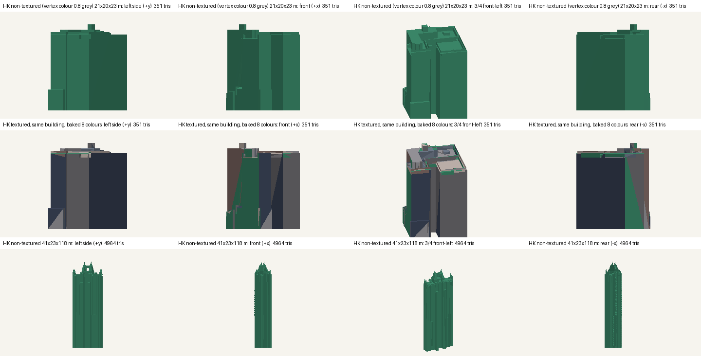
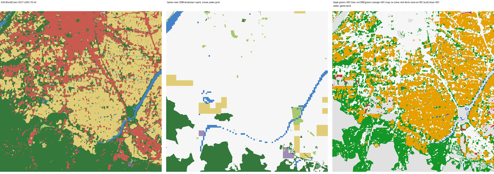

# Peakline 研究的補充（給 #821）

2026-10-19，session_01TuTDm5ortk7Jd18gAQrDkk。同一份任務書有兩份研究：Codex 的 #821（`docs/research/PEAKLINE_MAP_ENGINE_STUDY.md`）與這個 session 的 #820。**主報告是 #821**：完整盤點（C001–C141 有 crates.io 查核與 20 個來源包的授權檔、D01–D26、E01–E04）、KTX2 轉 PNG、減面、人物的 Rocketbox 授權缺口、WorldCover 重採樣與 11 類對照，都以它為準。這份只寫 #821 沒有、或和它結論不同的事，研究基準相同：main `43f6abc95bd4235a07f91480e401231cbf4cfe5f`、參考庫 `058f8333b195d5314cc7cbd49a87aaf1869b409d`。

不改程式、資料、App，不加依賴。存檔版本、決策號、golden schema 都不動。

## 1. 推薦任務要修正：不要用 `@gltf-transform/functions`

- 【已確認，`npm ls`】`@gltf-transform/functions` 4.5.1 依賴 `ndarray-pixels` 5.2.0 → `sharp` 0.35.5（Apache-2.0）→ `@img/sharp-libvips-linux-x64` 1.3.4，授權 **LGPL-3.0-or-later**（`@img/sharp-wasm32` 是 `Apache-2.0 AND LGPL-3.0-or-later AND MIT`）。#821 提交的 `offline-package-lock.json` 裡就有這些套件；它的 `tool-license-audit.json` 只記了 functions 本身的 MIT。
- `docs/HANDOFF.md` §3 同意的是「glTF-Transform 與 meshoptimizer，兩個都是 MIT」；copyleft 是作者保留的決定（CLAUDE.md）。所以 #821 §8 的任務實作時：
  - `tools/glb-to-m3dmodel/package.json` 只放 `@gltf-transform/core`、`@gltf-transform/extensions`（各 4.5.1）與 `meshoptimizer`（1.3.0）。【已確認】這樣只裝 5 個套件（另兩個是 `property-graph` 4.1.0、`ktx-parse` 1.1.0），全部 MIT，5.4 MB。
  - `dequantize`、`prune` 自己寫幾行（[`scripts/decode-glb.mjs`](peakline-2026-10-19/scripts/decode-glb.mjs) 示範了：`Accessor.getElement` 會還原正規化整數，未用的 mesh／accessor／material 照引用關係刪掉）。
  - 之後要減面，用 `meshoptimizer` 自己的 `MeshoptSimplifier`（同一個 npm 套件裡的 `meshopt_simplifier.js`），不必經 functions 的 `simplify`。
- 【樣本通過】只用這三個套件：`street-agents.glb` 的公車 12 個節點解 meshopt 後，main 上原封不動的 `convert.mjs`（配一份 scratch 的來源紀錄）輸出 2,488 面、7 色，與 #821 的結果相同。

## 2. 香港單體化模型其實拿得到

#821 走 `data11.map.gov.hk` 帶查詢參數得到 403，香港一節全部是 UNVERIFIED。這邊在同一天（06:19–06:22 UTC）用下載 API 頁面裡的網址格式 `https://download.map.gov.hk/api/3d-zip/{格式}/{圖幅}.zip`，**不帶任何金鑰**就取得了。403 的原因不確定（主機、參數或當下的網路），接手的人兩個都試。

### 2.1 大小：官方大小清單不可靠

| 圖幅 11-NW-10B（修訂日 2026-07-17） | 官方 `INDIVIDUAL_MODELS_DATA_SIZE.csv` | 實際下載（Content-Length） |
| --- | --: | --: |
| GLTF（有貼圖） | 5,723.7 MB | 861,053,392 B（解壓後 JPEG 737 MB＋bin 418 MB＋PNG 3 MB＋gltf 1.5 MB） |
| GLTF0（無貼圖） | — | 43,394,698 B（SHA-256 `08afd3762631690ae71ab2c9942717939c867dc7385d95d886fe8fefd03d926b`） |

#821 因為清單的 5.7 GB 沒有下載；實際的 zip 小很多，而且支援 HTTP Range：用 [`zip_range.py`](peakline-2026-10-19/scripts/zip_range.py) 讀中央目錄，就能只取一棟（4 個檔，171,507 B）。

### 2.2 內容（無貼圖整個圖幅、有貼圖一棟）

- 有貼圖包：161 棟建物、23 件基礎設施、13 件水體、4 件植被、1 件其他、1 件地形；每棟中位數約 2 MB。無貼圖包：同樣 161 棟，共 102,541 面（中位數 353、最多 4,964，沒有一棟超過轉換器的 15,000）。
- 格式：每棟一個資料夾，`.gltf`＋`.bin`（FME 2022.2／2023.1／2023.2），**沒有任何 glTF 擴充**。有貼圖版另有 1024² JPEG 與 128² PNG，外部 URI。
- 座標：網格是 z 上的公尺，節點矩陣轉成 y 上，平移是香港 1980 方格座標（例：E 836,813.4、N 822,643.8、高 70.13 m）；轉換器用 JS 的 double 套矩陣再移回中心，float32 沒有精度問題。
- 無貼圖版的頂點色**全部**是 (0.8, 0.8, 0.8)。

### 2.3 轉檔結果

先用 glTF-Transform core 把 `.gltf` 打包成 `.glb`（[`pack-glb.mjs`](peakline-2026-10-19/scripts/pack-glb.mjs)），再交給原轉換器：

| 樣本 | 原始 → 輸出 | 三角形／顏色 | 時間 |
| --- | --- | --- | --- |
| 無貼圖，21 × 20 × 23 m | 41,384 → 18,652 B | 353 → 351／1（**全部被當成塗裝**） | 0.03 s |
| 同一棟，有貼圖 | 171,507 B（4 檔）→ 18,676 B | 351／8（105 面誤當塗裝） | 0.09 s |
| 無貼圖，41 × 23 × 118 m | 567,068 → 258,528 B | 4,964／1 | 0.17 s |



圖是 Python 平行投影（每面一色、塗裝區換成示範綠），不是 Metal、不是 iPhone。美術判斷：單體模型多的是量體（退縮、塔樓、屋頂機房、尖頂）；立面窗格在照片貼圖裡，每面一色後只剩幾塊深灰與褐，和 #821 §3 的預期一致。

### 2.4 條款依取得路徑而不同

| 取得路徑 | 條款 | 多出來的義務 |
| --- | --- | --- |
| DATA.GOV.HK 資料集頁 | <https://data.gov.hk/en/terms-and-conditions>：免費商用、重製、散布；標示來源並給政府、相關機構與 DATA.GOV.HK 署名；賠償條款 | — |
| CSDI 入口 | <https://portal.csdi.gov.hk/csdi-webpage/doc/TNC>（#821 §7 已寫） | — |
| 地政總署 3D 地圖的下載 API（上面的網址） | 下載 API 頁的「Terms and Conditions of Use」：照 LandsD Map API 的條款與 IP 權利聲明 | 不可短時間大量呼叫；**地圖畫面要放地政總署標誌**與版權聲明（「Map from Lands Department」等） |

要散布轉出來的東西，就從 DATA.GOV.HK／CSDI 的資料集頁取得同一份資料，或照 Map API 的條款放標誌。樣本只在 scratchpad，這個 PR 沒有提交任何香港原始資料；上面的圖是轉檔後的投影，附了署名。

## 3. WorldCover：參考庫已經做好，而且空缺在平原

### 3.1 參考庫的現成產生程式與圖磚

CLAUDE.md 要先看作者的參考庫能不能移植。`Railway/taiwan-rail-reference-clean/source/` 已經有：

- `scripts/build_worldcover.py`（111 行）：四塊 3° GeoTIFF（N21E117、N21E120、N24E117、N24E120）→ 內政部縣市界的海岸遮罩 → 每個 zoom 最近鄰取 256 × 256 → 多邊形化、拓撲保留簡化 → MVT 的 `landcover` 圖層（`class` 為 wood、scrub、grass、farmland、built、bare、snow、water、wetland、mangrove、moss）。依賴：rasterio 1.4.3、shapely 2.0.7、mapbox-vector-tile 2.2.0、mercantile 1.2.1。
- 成品 `rail-3d/landcover/worldcover-2021/`：918 塊 z6–11（276 塊有內容），22,967,839 B，最大一塊 391,261 B，z11 約 70 m；`manifest.json` 有署名、DOI 與四塊來源的 SHA-256。
- `scripts/verify_worldcover_data.py`：抽 2,261 點和原始 GeoTIFF 比對。
- `docs/worldcover-0908.md`、`landscape-0908.md`：ESA 墊底、OSM 的水域、公園、道路、林地畫在上面；2026-09-12 起大片林地（> 10 公頃或最長邊 > 400 m）只上色、不長樹，理由是山區被示意樹鋪滿、每次停下要掃 0.5–1.5 秒。

#821 §5 的「離線 mask → 2D／3D 展示資料」可以直接從這套開始，不必另寫切圖。

### 3.2 平原與山區的對照

#821 比了集集一塊。這裡比了兩塊各 0.06° 見方（[`compare_cover.py`](peakline-2026-10-19/scripts/compare_cover.py)；WorldCover 用 GDAL `/vsicurl/` 只讀窗，1.5 秒，這個環境的 TLS 沒有問題）：

| | 宜蘭羅東—冬山（40.27 km²） | 平溪十分（40.14 km²） |
| --- | --: | --: |
| WorldCover 樹木／農地／建成區 km² | 13.96／14.18／10.68 | 39.82／0.01／0.29 |
| OSM 林地 km² | 4.10 | 37.59 |
| **WorldCover 樹木被 OSM 林地蓋到** | **29.2%** | **94.3%** |
| **WorldCover 農地落在遊戲農地分區** | **6.8%** | — |
| 現在什麼都沒畫的地（沒有 OSM 綠地、分區、水） km² | 33.40 | 2.48 |

山區 OSM 的林地已經幾乎完整，WorldCover 的收益在平原的農田與零碎林地。WorldCover 的大片樹若照現在的 `addArea(.wood)` 佔格，平原的城市就畫不出來；這點和 #821 §5 相同。數字在 [`cover-yilan.json`](peakline-2026-10-19/cover-yilan.json)、[`cover-pingxi.json`](peakline-2026-10-19/cover-pingxi.json)。



平溪的圖：[cover-pingxi.png](peakline-2026-10-19/cover-pingxi.png)。

## 4. 轉換器的其他缺口

【樣本通過】參考庫 142 個 GLB（`glbscan.py`）：113 個無擴充、13 個 meshopt（含 `street-agents.glb` 與 8 個人物）、**16 個 Draco＋WebP**（`procedural_assets_reference_clean` 的 tiny-cubes）。所有 meshopt 檔的資料流都是索引 codec 1、頂點 codec 0（`meshopt_codecs.py`）。

#821 已寫的（非 AI 來源紀錄、地理模型不能套「長 12 m」的縮放）之外，樣本還碰到：

| 缺口 | 影響 | 處理 |
| --- | --- | --- |
| 只讀 `.glb` | 香港與 FME 類工具輸出 `.gltf`＋外部 `.bin`＋外部貼圖 | 橋接任務讀檔時用 glTF-Transform core 一起收 |
| 淺色中性色一律當塗裝（alpha 0） | 香港無貼圖建物整棟變塗裝，有貼圖的也有 105 面 | 非車輛的模型要能關掉這條規則 |
| 名稱有 `lamp`／`light` 就夜裡發光 | 街景公車的尾燈也亮（112 面） | 尾燈亮其實合理；寫進 README 即可 |
| Draco | 16 個 tiny-cubes 模型 | 要另加 `draco3dgltf` 1.5.9（npm 的 `license` 是 Apache-2.0），作者決定；先拒絕 |

## 5. #820 這邊修正的事

- 原本提交了一張 `street-agents.glb` 公車轉檔後的對照圖。HANDOFF §3 規定參考庫模型的原檔與對照留在 scratchpad 或私有參考庫，所以已經拿掉；#821 的做法是對的。
- 原本的完整盤點、引擎套件分析與授權總表和 #821 重複，而且 #821 有 registry 與包內授權檔的查核，所以刪掉，改以 #821 為準。
- E03（Jonas Schievink 的 ISC 文字）：附錄 C 裡授權原文是 ISC 的只有 C053 libloading，它的 LICENSE 是「Copyright © 2015, Simonas Kazlauskas」（上游 `master`，2026-10-19 讀），所以這段不是 libloading 的；歸屬仍待查，和 #821 的結論一致。

## 6. 驗證狀態

**VERIFIED（雲端 Linux，scratchpad）**：三個 MIT 套件與加裝 functions 時的 `npm ls`；香港兩個圖幅的 HEAD、無貼圖完整下載與 SHA-256、有貼圖的 Range 讀取、三個轉檔樣本；官方大小清單的那一行；參考庫 WorldCover 檔案的內容與 manifest；兩塊 WorldCover 比較（分區解碼的全台總數與 `tools/real-world-population/README.md` 相同）；142 個 GLB 的擴充統計與 meshopt codec 標頭；條款頁當天讀過。

**UNVERIFIED**：iOS、Simulator、實機的畫面、幀時間、GPU 記憶體與 App 大小；`data11` 主機 403 的原因；參考庫 WorldCover 圖磚接進 App 後的大小（估 10–23 MB，沒量）；Draco。

## 7. 重現

腳本在 [`peakline-2026-10-19/scripts/`](peakline-2026-10-19/scripts/)，只是研究用。在 repo 根目錄、參考庫 clone 在 `$REF`：

```sh
mkdir -p "$TMP/gltf" && (cd "$TMP/gltf" && npm init -y >/dev/null && \
  npm install --save-exact @gltf-transform/core@4.5.1 @gltf-transform/extensions@4.5.1 meshoptimizer@1.3.0 && npm ls --all)
export GLTF_MODULES="$TMP/gltf/node_modules"
P=docs/research/peakline-2026-10-19/scripts
python3 -I $P/glbscan.py $(find "$REF" -name '*.glb')
node $P/decode-glb.mjs "$REF/Railway/street_scene_reference_clean/source/models/street-agents.glb" "$TMP/sa-bus.glb" --model bus

# 香港：無貼圖整幅；有貼圖只讀一棟
curl -o "$TMP/gltf0.zip" https://download.map.gov.hk/api/3d-zip/GLTF0/11-NW-10B.zip
python3 -I $P/zip_range.py https://download.map.gov.hk/api/3d-zip/GLTF/11-NW-10B.zip get BUILDING/B368132264501063A0/ "$TMP/hk"
node $P/pack-glb.mjs "$TMP/hk/BUILDING/B368132264501063A0/B368132264501063A0.gltf" "$TMP/hk-textured.glb"
echo '{"hk":{"tasks":[{"source":"LandsD 3D Visualisation Map 11-NW-10B"}],"credits":0}}' > "$TMP/gen.json"
node $P/run-convert.mjs "$TMP/hk-textured.glb" "$TMP/hk.m3dmodel" hk +x 20.875 "$TMP/gen.json"
python3 -I $P/render_m3d.py "$TMP/hk.png" "HK=$TMP/hk.m3dmodel"

# WorldCover（rasterio 1.4.3、shapely 2.0.7、mapbox-vector-tile 2.2.0、mercantile 1.2.1 的 venv）
python $P/wc_window.py 121.74 24.62 121.80 24.68 "$TMP/yilan"
python $P/compare_cover.py "$TMP/yilan.npy" 121.74 24.62 121.80 24.68 . "$TMP/cover-yilan"
```
