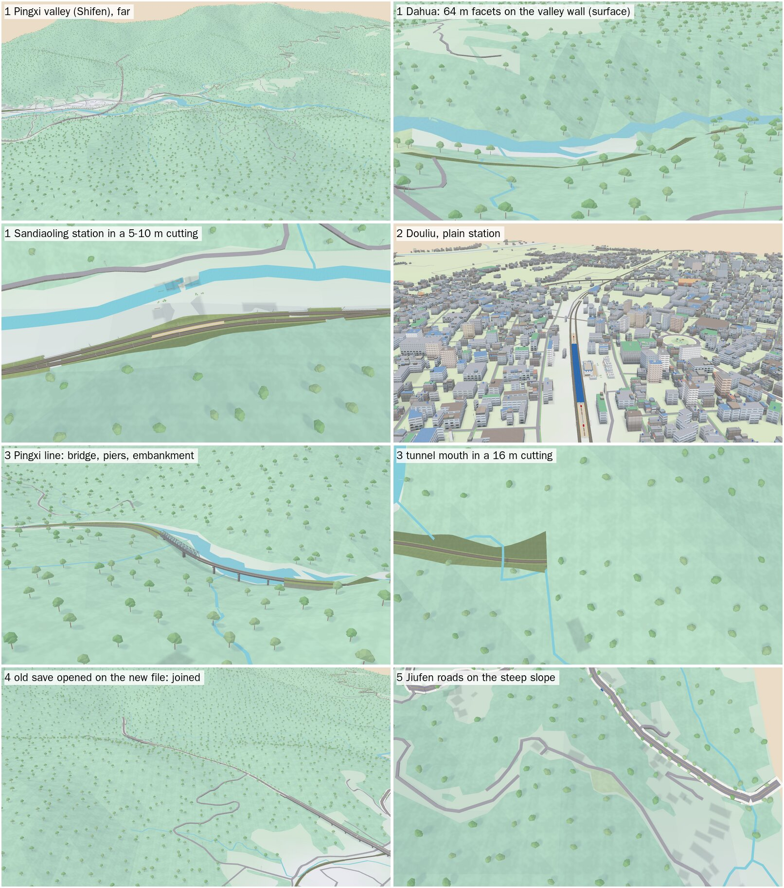

# TERRAIN-CHECK-A：換成內政部 20 m DTM 之後看五個場景（2026-11-24）

工作串 TERRAIN-CHECK-A（協調者第 3 任派工，評分 3.55：玩家 4、開發 4、美術 4、鐵道迷 4、音樂 1）。題目在私有庫 `docs/priorities/TERRAIN-DETAIL-3D.md` 第 1 順位：#2621（決策 943）合併後，在新地面上看五個場景，各答「沒問題／表面問題／形狀問題」，決定後面要不要做材質細節或局部地形細節。只截圖、讀現成數字；遊戲的程式、規則、資料、測試都沒改。

## 結論

| # | 場景 | 結論 | 一句話 |
| --: | --- | --- | --- |
| 1 | 窄河谷（平溪線：三貂嶺、大華、十分、平溪） | **表面問題** | 陡的谷壁看得到一排 64 m 的三角切面，整片山同一種綠，沒有岩壁；形狀只有三貂嶺一站偏深的路塹，輕 |
| 2 | 平原車站（斗六） | 沒問題 | 站體、月台、路基貼地，新舊幾乎同一張圖 |
| 3 | 橋與隧道交界（平溪線、宜蘭線瑞芳到三貂嶺） | 沒問題 | 橋面接路堤、洞口接路塹，高度都連續；另有一件不是地形細節管的事（短橋鋪成路堤），另評 |
| 4 | 舊存檔的新舊地塊接縫（`HeightGridJoin`） | 沒問題 | 接上後地面連續，圖上看不出接縫；軌道實際鋪過接縫沒有拍到（見下） |
| 5 | 地面超坡最密處（平溪線、九份的山路） | 沒問題 | 軌道格旁沒有台階、鋸齒或大面積削山；坡面的三角切面就是場景 1 那一項 |

**不是「全部沒問題」，所以不寫結案**：看到的是表面問題，照 TERRAIN-DETAIL-3D 的順序，下一步是第 2 順位「3D 地面材質細節」（可以派了，先做最便宜的一步：地面的法線改成平滑的）。形狀問題只有一處、而且輕，第 3 順位「局部地形細節」不派；C（32 m 地面）照舊不做。

總覽圖：`docs/art/terrain-check-a-2026-11/overview.jpg`。其他圖（新舊並排、近景、接縫）在私有素材庫 `a91453/railway-assets-private-2` 的 `game-art-previews/docs/art/terrain-check-a-2026-11/`。

## 怎麼看的

- 圖用 `tools/map3d-preview/`（決策 238）：Swift 蓋好的場景輸出後，在無頭 Chromium 裡照 `Map3DShaders.metal` 的算式畫。**不是 iPhone 的畫面**，但網格、頂點法線、顏色和 App 是同一份；抗鋸齒與精度不同。`website-screenshots.yml` 沒有跑（它的場景不在這五個地方）。
- 世界：`MAP3D_WORLD=realdemo`（瑞芳、平溪的實景示範，軌道是 `TrackRise` 鋪的，和收購真實路線同一套）與 `MAP3D_WORLD=island MAP3D_AT=23.7117:120.5413 MAP3D_BUY_STATION=斗六`；都開 `MAP3D_HEIGHTS=1 MAP3D_BASEMAP=1 MAP3D_LANDCOVER=1 MAP3D_REAL=1 MAP3D_FOOTPRINTS=1`，14:00 的光。
- 鏡頭：遊戲近景的自動傾角（距離 300–900 m）為主；另拍壓低到 68–72° 的側看圖，只用來找毛病。
- 新舊對照：照 `docs/handoff/MOI-DTM-20M.md` §4，把 `daea5fb` 的 `taiwan_heights.dat` 與 `taiwan_water.json` 暫時放回去再跑同樣的鏡頭。**程式是 main 的**（決策 943 §5 的三處小修也在），所以「舊」是「main 的程式＋舊資料」，不是整個 `daea5fb`。
- 場景 4 另在預覽工具的臨時複本裡加了三個開關（示範世界用舊高度檔建、開啟時照 `GameSession.heights` 的 didSet 接上新檔；不接的對照；印一條線上的地面高度），用完刪掉，沒有進這個 PR。
- 沒做到的：沒有和實景照片並排（這個環境沒有照片來源）；沒有實機畫面。

## 場景 1：窄河谷：表面問題

看的地方：三貂嶺到菁桐整條平溪線，近景在三貂嶺站、大華的河彎、十分站、平溪站。

1. **谷壁的三角切面（表面，中）**。大華一帶基隆河對岸的陡坡，壓低一點看是一排明暗相間的三角形，像一排帳篷（總覽圖右上）。原因是地面每 64 m 一格、每格兩個三角形各用自己的面法線（`Map3DScene.Builder.addGround`），坡越陡、相鄰兩面的明暗差越大。高度沒有錯，是打光的法線造成的。新舊資料都有，不是 #2621 帶來的；從正上方看幾乎看不到，鏡頭壓低、坡陡才明顯。
2. **整片山同一種綠（表面，輕到中）**。山坡是一種薄荷綠加均勻的樹，沒有岩壁、崩壁、河階的顏色差；光線又是故意打平的（model-look §2），所以遠看只有一條白色的谷底和藍色的河，谷有多深看不出來。
3. **車站落在路塹裡（形狀，輕，只有一處明顯）**。58 m 的格把山壁、路基和河平均在一起，軌道所在的那一階就埋在平均出來的斜坡下：

   | 站（收購平溪線的月台，對地面的高度 m） | 舊 | 新 |
   | --- | --- | --- |
   | 三貂嶺 | 5 m 以內 | −7.4、−10.0、−5.2 |
   | 十分 | −5.3、−6.8 | −2.7、−4.8 |
   | 望古 | −8.2 | −3.1 |
   | 平溪 | 5 m 以內 | −3.6 |

   十分、望古變淺了（十分老街兩旁的橄欖色邊坡變窄），三貂嶺變深：站在一條 8–10 m 深、邊坡約 30 m 寬的塹裡，真實的三貂嶺是山壁與河之間的一階。只有這一站明顯，而且從遊戲鏡頭看是一條綠色邊坡，不是破圖。
4. 谷底偏寬偏平：有，但輕。河是底圖的向量線鋪在地面上，白色的谷底是地表覆蓋的顏色，不是被填平的高度。

判定：主要是 1 與 2，都是不動高度就能改的 → 表面問題。3、4 是形狀，輕，不夠派局部地形細節。

## 場景 2：平原車站：沒問題

斗六（`MAP3D_BUY_STATION=斗六`）：站房、月台、股道、道床貼在地面上，周圍的路與房子沒有浮空或下陷，新舊兩張幾乎一樣（平原上 DTM 與 GLO-30 的差是整片平移）。收購路線的報告裡，平原與市區車站的月台都在地面或原本的高架上（沙崙線中洲 6.4 m 路堤、高雄環狀線駁二大義 5.8 m，新舊相同）。

## 場景 3：橋與隧道交界：沒問題

看的地方：平溪線三貂嶺到大華之間的隧道群與河邊的橋、宜蘭線三貂嶺隧道北口、瑞芳到猴硐的隧道與橋、四腳亭到瑞芳的短隧道。

- **橋接路堤**：平溪線沿河那座（總覽圖「3 bridge」）桁架、橋墩、橋面到路堤是一條連續的線，橋台處沒有落差。
- **洞口接路塹**：洞口前的路塹最深 16.6 m（舊 21.1 m），邊坡往洞口張開成一個楔形，洞口在楔形的尖端，上面的地面蓋過去；沒有軌道浮在地面上或地面蓋住露天軌道的地方。
- 新地面上假的隧道少了：示範地圖的隧道 33 段 5.70 km → 19 段 3.90 km，少掉的是樹冠與屋頂造成的假山；對到真實隧道的取樣（15 條收購路線）296/356 → 298/353，沒有少。
- 兩件小事，都不是高度接續的問題：
  - 小溪的藍線會爬過路塹的邊坡（溪是底圖的線鋪在畫出來的地面上）。新舊都有，很小。
  - **短橋鋪成路堤**：宜蘭線在三貂嶺站南邊過基隆河那一段，舊地面是 82 m 高架（離地 12.2 m），新地面是 82 m 路堤（7.8 m），圖上是一條綠色路堤橫過藍色的河。河比 58 m 的水域格窄，沒有水域格就不成橋；新地面的谷底又比較高，離地不到高架的門檻。這類情形本來就有：收購四條支線時，真實是橋的取樣舊 14/34、新 11/33 鋪成橋或高架（15 條線合計 1,526/1,631 → 1,528/1,633，沒變）。它要改的是「軌道跨過畫出來的河就是橋」的規則，不是地形細節，另評一項（私有庫 `docs/priorities/TERRAIN-CHECK-A.md`）。

## 場景 4：舊存檔的新舊地塊接縫：沒問題

做法：示範世界用舊高度檔建（49 個地塊是 Copernicus 的高度），再照 App 開存檔的做法給新檔，`GameWorld.groundJoining` 讀進外圍一圈 90 個地塊並接上。對照組是同一圈不接、照檔案原樣讀。

- 三條穿過接縫的線（十分北邊，每 32 m 一點的地面高度）：

  | 線 | 不接：接縫那一步 | 接上：接縫那一步 | 圈內最大的差（舊比新高） |
  | --- | --- | --- | --- |
  | 南北，x = −1230 | 274.2 → 267.0（應該是上坡，掉了約 17 m） | 274.2 → 284.0 | 18.3 m |
  | 東西，z = 3600 | 261.1 → 265.8（多 13 m 的一階） | 274.5 → 265.8 | 18.3 m |
  | 南北，x = −200 | 205.5 → 193.6（掉 12 m） | 205.5 → 206.5 | 12.9 m |

  接上之後，差在 1,024 m 的地塊裡淡出到 0，等於那一圈多了最多約 1.8% 的斜度；圈的外緣和檔案相同。
- 圖：接與不接並排，森林的山坡上兩邊都看不出接縫（不接的 12–18 m 落差在打平的光線下也不明顯），接上的那張沒有任何線。
- **沒拍到的**：軌道實際鋪過接縫的畫面。示範世界的軌道都在舊地塊裡；預覽工具的 `MAP3D_LINE` 在這種地形上鋪不出線（`invalidTrackStructure`），要用 `GameSession` 的鋪線流程才行，超出「只截圖」的範圍。依數字推：地面連續、多出的斜度 ≤ 1.8%，`TrackRise` 會當成一般的緩坡處理。這一點是 UNVERIFIED（沒有畫面），實機上請用 0.6.0 (145) 以前的存檔往外延伸一條線看一次。

## 場景 5：地面超坡最密處：沒問題

看的地方：平溪線全線的軌道兩旁、瑞芳往九份的山路（汽車路的髮夾彎）。

- 軌道格旁（決策 737 鎖住不整平的角點）：邊坡從軌道往外平平地接到地面，沒有一格一格的台階，沒有鋸齒狀的邊，也沒有大片被削掉的山；最寬的邊坡是洞口前那個 16 m 深的楔形，約 60 m 寬。
- 九份的路：貼著坡面走，髮夾彎沒有折斷或懸空，近景與側看都平順。
- 新地面讓這一帶的土方變少：示範地圖的路塹 153 段 11.45 km（最深 21.1 m）→ 102 段 7.28 km（16.6 m）；收購 15 條線的取樣裡，深過 5 m 的路塹 113 → 67 點，深過 10 m 的 17 → 10 點。
- 側看時坡面的三角切面在這裡也看得到，就是場景 1 的第 1 點，不另算。

## 順便量的：路塹、路堤、隧道、高架公里數

現成的報告 `LineHeightReportTests`（`LINE_HEIGHT_REPORT=1`，決策 612 的 15 條可收購路線，各在自己的開局上收購，沿主線每 64 m 一點記遊戲鋪成什麼）。每點算 64 m；「舊」是 main 的程式配 `daea5fb` 的兩個資料檔。單位 km，舊 → 新：

| 路線 | 地面 | 路堤 | 路塹 | 高架 | 橋 | 隧道 |
| --- | --: | --: | --: | --: | --: | --: |
| `PINGXI` | 5.31 → 8.06 | 2.30 → 1.41 | 4.61 → 3.46 | 0.51 → 0.00 | 0.00 → 0.00 | 0.83 → 0.64 |
| `JIJI` | 20.74 → 22.59 | 2.82 → 1.66 | 4.48 → 3.71 | 0.00 → 0.06 | 0.19 → 0.19 | 1.79 → 1.79 |
| `NEIWAN` | 12.99 → 13.44 | 2.82 → 2.50 | 2.43 → 2.69 | 1.15 → 1.22 | 0.00 → 0.06 | 1.28 → 0.77 |
| `SHENAO` | 2.18 → 3.26 | 1.34 → 0.90 | 1.60 → 1.09 | 0.13 → 0.00 | 0.00 → 0.00 | 0.00 → 0.00 |
| `LIUJIA` | 0.00 → 0.00 | 0.00 → 0.00 | 0.00 → 0.00 | 3.78 → 3.78 | 0.00 → 0.00 | 0.00 → 0.00 |
| `SHALUN` | 0.00 → 0.00 | 0.64 → 0.64 | 0.00 → 0.00 | 5.57 → 5.57 | 0.00 → 0.00 | 0.00 → 0.00 |
| `ntdlrt:V` | 1.73 → 1.60 | 0.64 → 0.77 | 0.38 → 0.32 | 5.12 → 5.12 | 0.00 → 0.00 | 0.00 → 0.00 |
| `ntdlrt:VB` | 1.98 → 1.92 | 1.41 → 1.66 | 0.13 → 0.00 | 5.50 → 5.44 | 0.00 → 0.00 | 0.00 → 0.00 |
| `ntalrt:K` | 0.83 → 0.90 | 0.32 → 0.45 | 0.64 → 0.51 | 5.50 → 5.44 | 0.00 → 0.00 | 0.58 → 0.58 |
| `trtc:R_XBT` | 0.00 → 0.00 | 0.00 → 0.00 | 0.00 → 0.00 | 1.60 → 1.60 | 0.00 → 0.00 | 0.00 → 0.00 |
| `trtc:G_XBT` | 0.19 → 0.13 | 0.26 → 0.26 | 0.32 → 0.38 | 0.90 → 0.64 | 0.00 → 0.00 | 0.77 → 1.02 |
| `sanying:LB` | 0.00 → 0.00 | 0.00 → 0.00 | 0.00 → 0.00 | 14.08 → 14.08 | 0.32 → 0.32 | 0.00 → 0.00 |
| `trtc:BR` | 0.70 → 0.58 | 1.15 → 0.90 | 0.64 → 0.83 | 20.10 → 20.48 | 0.26 → 0.19 | 3.90 → 3.78 |
| `tymc:A` | 1.15 → 0.96 | 0.83 → 1.02 | 1.86 → 1.47 | 37.12 → 37.25 | 0.58 → 0.58 | 11.33 → 11.58 |
| `krtc:C` | 20.29 → 20.35 | 0.64 → 0.64 | 0.00 → 0.00 | 0.90 → 0.83 | 0.00 → 0.00 | 0.00 → 0.00 |
| **合計** | 68.10 → 73.79 | 15.17 → 12.80 | 17.09 → 14.46 | 101.95 → 101.50 | 1.34 → 1.34 | 20.48 → 20.16 |

- 地面上的三種（地面、路堤、路塹）：路塹 17.09 → 14.46 km（−15%），路堤 15.17 → 12.80 km（−16%），貼地 68.10 → 73.79 km（+8%）。支線最明顯：平溪線貼地 5.31 → 8.06 km，舊地面上 0.51 km 的假高架沒了。
- 高架、橋、隧道合計幾乎不變（123.77 → 123.00 km）：它們跟著真實的結構走（決策 279、315），不跟地面。
- 示範地圖（瑞芳、平溪，`RealWorldDemo`，各段長度加總）：路塹 11.45 → 7.28 km、路堤 8.27 → 8.26 km、隧道 5.70 → 3.90 km、高架 2.14 → 3.36 km、橋 1.52 → 1.64 km。高架變多的地方是猴硐、牡丹這類站：地面降到谷底的高度，站前後的軌道離地 8–10 m。

## 給下一步的建議

1. **第 2 順位「3D 地面材質細節」可以派**，照這個順序做、每一步都能單獨停：
   1. 地面的法線改成相鄰格平滑過的（只動 `addGround` 寫進頂點的法線，高度、三角形數、存檔都不動）。這一步就能拿掉谷壁那排帳篷，最便宜。
   2. 依坡度換顏色：陡過某個坡度的面用岩壁的顏色，其餘照地表覆蓋。
   3. 細節法線、岩壁貼圖：前兩步做完還嫌平再做，要量 iPhone 的幀時間。
   驗收鏡頭：大華河彎（場景原點起 x 700、z 3550，側看 70°）、十分全景、九份山路，本報告的圖當「改之前」。
2. **第 3 順位「局部地形細節」不派**：形狀問題只有三貂嶺站的路塹一處，而且輕；它其實是軌道縱斷面與 58 m 格的事，畫面上加起伏改不了月台在塹裡。
3. **C（32 m 地面）不重提**：這次沒有看到材質細節做不到、非 C 不可的東西。
4. 另評一項：支線跨河的短橋鋪成路堤（私有庫 `docs/priorities/TERRAIN-CHECK-A.md`）。
5. 實機補看一次：用舊存檔往新地塊延伸一條線（場景 4 沒拍到的那一點）。

## 五方（這份報告的判定）

- 玩家：換資料後鋪線與車站看起來合理，土方變少；剩下的是山坡看起來平、谷壁有切面，改法便宜。
- 鐵道迷：真實的隧道、橋、高架照舊對得上；支線的短橋有三分之二沒鋪成橋，是老問題，另評。資料來源不變（內政部 2026 年版 20 m DTM，決策 943）。
- 開發：沒有改程式；下一步只動 3D 地面的法線與顏色，不碰 GameCore、存檔、golden。
- 美術：打平的光線下，立體感要靠相鄰面的顏色差；現在的面法線給了錯的顏色差（切面），平滑後再用坡度分色補回來。
- 音樂：無。

## 驗證

- VERIFIED（雲端 Linux，Swift 6.4）：`swift build --build-tests -Xswiftc -warnings-as-errors` 乾淨（main `12561cb`）；`LineHeightReportTests` 新舊資料各跑一次；`Map3DPreviewDump` 各場景輸出後用 `tools/map3d-preview/render.sh` 畫出。
- UNVERIFIED：iPhone 實機畫面（要 TestFlight）；軌道鋪過新舊接縫的畫面。
- 參考庫與外部專案：沒有用到（只看圖、讀數字）。
