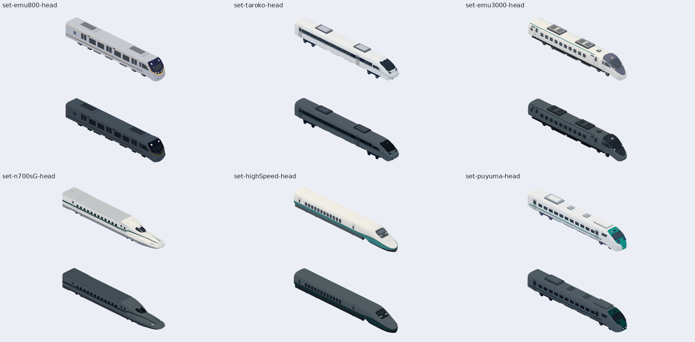

# 共用做車工具（`tools/train-models/`）

一個車型 id（`Map3DModelPack.standard` 裡的名字，如 `set-emu800-head`）進去，出來的是：原生 `.m3dmodel`、七向圖（用遊戲的模型光）、三角形預算結果、雜湊對照、一頁離線預覽。以後新車只用這個工具；`.claude/skills/rolling-stock/SKILL.md` 說怎麼做車，這裡說怎麼量與怎麼拍。



## 用法（Linux 與 macOS 都行；Swift 6.4、Node 22、playwright、Chromium、Pillow）

```sh
# 1. 匯出（debug 版，@testable import；第一次會 build 約 3 分鐘）
tools/train-models/run.sh OUT --tag after                      # 全部列車（set-*、style-*）及它們的遠景版
tools/train-models/run.sh OUT --tag after --ids set-emu800-head,set-taroko-head
# 2. 檢查：預算＋雜湊（失敗時 exit 1）
node tools/train-models/check.mjs OUT
node tools/train-models/check.mjs OUT --new-set emu900         # 新車：精細車一定要有遠景版
node tools/train-models/check.mjs OUT --allow set-emu900-head  # 刻意改了這個模型：PR 要逐項說明
# 3. 七向圖（top bottom left right front back isometric；--time day|night|both）
node tools/train-models/render.mjs OUT --time both [--ids a,b] [--line '#2F6DB5']
# 4. 離線預覽頁與總覽圖
node tools/train-models/viewer.mjs OUT/index.html OUT              # 給兩個資料夾（before after）就左右並排
python3 -I tools/train-models/overview.py OUT overview.png --time both set-emu800-head set-taroko-head
```

`OUT/png/<光>/<id>-<視角>.png`；七向都是同一個模型自己的框、透明底。`index.html` 把圖與數字嵌進去，離線可開。

## 它量什麼

- **光**：`render.mjs` 的光照是 `map3dLit(…, soft: true)`（決策 370 的模型光：`0.85 − 0.05·lights + 0.02·朝上 + 0.15·太陽`，冷到暖的色，乘 `(天空光 + 0.5·太陽光) / (0.925, 0.871, 0.806)`）。天空光、太陽光、太陽方向與 `lights` 由 `export.swift` 從 `Map3DLighting(minute:)` 寫進 manifest 的 `lighting`：`day` 是 14:00，`night` 是 23:00（路燈亮、發光三角形加 `1.3·lights`）。假設列車朝東；沒有霧、太陽陰影、`map3dFinish`。`--features 1` 畫決策 450 的車窗反光與不鏽鋼光澤（天空從霧色到天頂色、太陽亮點；沒有 `u` 的遮蔽），不加就沒有。WebGL 是預覽，不代表 iPhone 的 Metal。alpha 0 的頂點（塗裝帶）用 `--line` 的顏色。
- **預算**（`budgets.json`，每一條寫了決策）：近景一節 ≤ 20,000（決策 417，超過要另做中間版）；十二節一列近景 ≤ 240,000（417 的 lower 級 250,000 要留空間）、遠景一列 ≤ 120,000；遠景一節要少於近景的一半（決策 420、432 的測試）且在近景的框裡（長度 0.1 m、頂 0.05 m、貼地 0.1 m）；精細車（一節 ≥ 8,000）用 `--new-set` 時一定要有遠景版（417 規則 1）。第一天 main 上已經違反的 set 記在 `grandfathered`（`check.mjs --grandfather-write` 只在這一天用過一次）：新車不准加進去。
- **雜湊**：`hashes.lock.json` 是 `Map3DModelPack.standard` 全部 417 個模型的三角形數與 FNV-1a（每個頂點所有欄位，同 `Map3DEMU800IntegrationTests.hash`，所以雜湊可以直接貼進釘模型的測試）。模型變了就紅；新模型要把它加進鎖（`run.sh OUT --lock tools/train-models/hashes.lock.json`），刻意改的用 `--allow` 並在 PR 說明。

## 之後的「改前／改後」（路線圖第 1–3 項，這次沒做）

- 兩次匯出到兩個資料夾（`--tag before`、`--tag after`），各自 `render.mjs`，`viewer.mjs 頁 before after` 並排。
- `renderer.js` 的 `render(view, {time, features})`：`time` 已有日／夜（夜裡發光三角形加亮）；`features` 是整數旗標，已傳給片段著色器（`uniform int features`），第 1 項（夜間亮窗、方向幕）、第 2 項（遮蔽烘進頂點色，在頂點色裡，不用旗標）、第 3 項（車窗反光、不鏽鋼光澤）在這裡加分支，同一個工具拍兩邊。第 3 項已做（決策 450）：旗標 bit 0，`render.mjs OUT --features 1`；M3DM 的 flags bit 1 是玻璃、bit 2 是不鏽鋼（遊戲的 `Map3DModelFile` 只讀公車檔，不讀這些匯出檔）。
- 數字進 manifest：`glowTriangles` 已經記每款幾個發光三角形，第 1 項的 PR 前後可比；決策 450 加了 `glassTriangles`、`steelTriangles`。

## 取代了哪些舊資料夾的哪些功能

舊資料夾不搬、不刪，它們的輸出與固定雜湊逐位元不變；新車不再開新資料夾。

| 舊資料夾 | 被取代的功能 |
| --- | --- |
| `train-modeling-410`、`train-pack-lrt`、`codex-trains-399`、`hsr-trains-408`（`export.swift`／`render.mjs`） | 把 pack 裡的列車寫成 `.m3dmodel`、同一相機拍圖、列出三角形數 → `run.sh`＋`render.mjs`＋`manifest.json` |
| `mesh-lod-420`（`export.swift`／`render.mjs`） | 近景與遠景的三角形比較 → `check.mjs` 的遠景規則；簡化器本身（`Map3DMeshSimplifier`）仍用 420 的匯出 |
| 各車資料夾（`c341`、`e1000-pp`、`e500-refresh`、`emu3000-refresh`、`emu3000-slate`、`emu500`、`emu800-native`、`emu900-native`、`seven-car-blue`、`temu1000`、`temu2000`、`train-colors`、`train-shape-refresh`）的 `export.swift`、`render.mjs`、`verify*.mjs`、各自的三角形預算與雜湊釘在測試裡的檢查 | 寫原生、七向圖、預算、雜湊 → 本工具的 `run.sh`、`render.mjs`、`check.mjs` |
| 同上各資料夾的 `viewer.html`、`standalone.mjs` | 離線預覽 → `viewer.mjs` |
| `c371-c381` 的單元匯出、日夜七向與雜湊 | 改用本工具；該資料夾保留六車原生編組、GLB、拓撲及車輪故障驗收、白模／剪影、真前後、完整 ZIP 與下載驗收。 |
| 沒有取代 | GLB 打包（`package.mjs`、`glb-audit.py`、Blender 檢查）、`bundle.py`／ZIP、`geometry-audit`、`glass-mutations`、`front-audit`、`door-audit`（逐車的專用驗收）、`glb-to-m3dmodel`（GLB → 原生）、`trains/`（網頁版 `Web/CityView`）、`train-colors/` 的新舊逐頂點比對 |

交給作者看的完整包（GLB、ZIP、viewer）照 CLAUDE.md 放私庫 `Railway/game-art-previews/docs/art/`；這個工具只做公開庫該有的：預算、雜湊、七向圖與離線預覽。

610 四輛展示：匯出12個 `taipei610-{a,c,d,b}{,-far,-light}` ID，另加 `--assembly taipei610`，輸出既有合法M3DAssembly及僅供逐bytes驗證的expected buffer。renderer支援同一assembly契約。新原生匯出逐頂點讀回；Swift6.4 integrated backend和一般SwiftPM backend皆可連結。610專用原生拓樸／變異驗收放 `tools/taipei610-audit/`；GLB沿用EMU900工具，不複製其他車配方。
